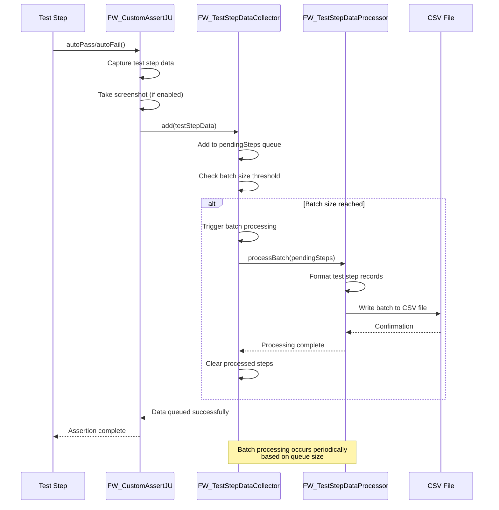

# FW_TestStepDataCollector Class Flow

<!-- ===============================================================
@file: Diagram-Adding-data-to-datacollector.md
@filepath: src/test/java/framework/.docs/Diagram-Adding-data-to-datacollector.md
@version: 1.2.0
@updated: 2025-10-30 12:02:00 PM CDT
@author: Greg Paskal
@company: MissionWares

@description:
Visual sequence diagram illustrating the data flow and interactions between
components when test step data is collected and processed in the automation
framework. This diagram shows how test results flow from test execution through
the data collection pipeline to CSV file storage. Key components include the
custom assertion utility, data collector, queue management, and batch processing
logic.

@dependencies:
- Mermaid diagram rendering support
- Related classes: FW_CustomAssertJU, FW_TestStepDataCollector, FW_TestStepDataProcessor

@tags: architecture, sequence-diagram, data-flow, test-collection, mermaid, mAi™

@changeLog:
Date        Author          Version  Description
----------  --------------  -------  --------------------------
2025-01-01  G. Paskal       1.0.0    Initial diagram creation
2025-09-09  G. Paskal       1.1.0    Added mAi™ header and fixed typo
2025-10-30  G. Paskal       1.2.0    Version update for documentation overhaul
=============================================================== -->

## Overview

This sequence diagram illustrates the complete flow of test step data collection in the automation framework, from test completion through to CSV file persistence.

## Sequence Diagram

## Key Features

### Data Collection Strategy
- **Asynchronous Collection**: Test steps are queued without blocking test execution
- **Batch Processing**: Data is written to CSV in configurable batch sizes
- **Thread-Safe Operations**: Concurrent test execution supported via synchronized collections
- **Memory Efficient**: Automatic flush prevents memory overflow on long test runs

### CSV File Management
- **Automatic File Creation**: CSV file created on first data write
- **Header Management**: Column headers written once at file creation
- **Append Mode**: New data appended to existing file during test run
- **UTF-8 Encoding**: Ensures proper character encoding for international characters

### Processing Thresholds
- **Default Batch Size**: 100 test steps
- **Configurable Threshold**: Adjustable via testConfig.properties
- **Forced Flush**: Manual flush available for immediate persistence
- **Final Flush**: Automatic flush on test suite completion

## Data Flow Stages

1. **Test Step Completion**: autoPass/autoFail methods capture test results
2. **Screenshot Capture**: Optional screenshot taken for visual validation
3. **Queue Addition**: Test step data added to pending queue
4. **Threshold Check**: Batch size evaluated for processing trigger
5. **Batch Processing**: Pending steps formatted and written as CSV records
6. **File Persistence**: Data appended to CSV file with proper encoding
7. **Queue Cleanup**: Processed steps removed from memory

## Related Components

- **FW_CustomAssertJU**: Entry point for test step data collection
- **FW_TestStepDataCollector**: Manages queuing and batch coordination
- **FW_TestStepDataProcessor**: Handles CSV formatting and file I/O
- **FW_TestStep**: Data object containing step metadata and results
- **FW_CSVUtils**: Utility methods for CSV file operations

## CSV Output Schema

The generated CSV file includes the following columns:
- Test Run ID
- Test Suite Name
- Test Case Name
- Test Step Number
- Step Description
- Pass/Fail Status
- Execution Timestamp (UTC)
- Duration (milliseconds)
- Screenshot Path
- Error Message (if failed)

## Performance Considerations

- **Memory Usage**: Queue size directly impacts memory footprint
- **I/O Operations**: Batch writing reduces file system overhead
- **Thread Safety**: Synchronized operations ensure data integrity
- **Immediate Persistence**: CSV data written immediately vs. held until test completion
- **Data Persistence**: All test steps are eventually written to CSV for data lake ingestion

## Related Diagrams

- [Architecture Overview](Diagram-Architecture.md)
- [Maven to First Test Case](Diagram-Maven-to-first-Test-Case.md)
- [Test Completion to BigQuery](Diagram-Automation-completed-to-Google_BigData.md)