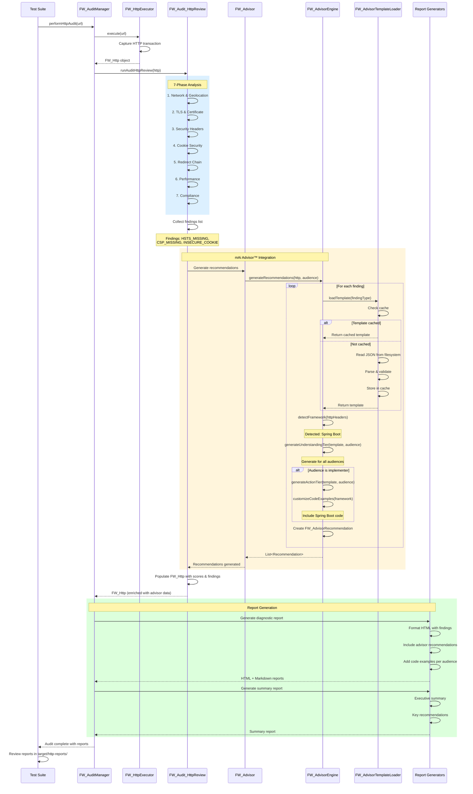
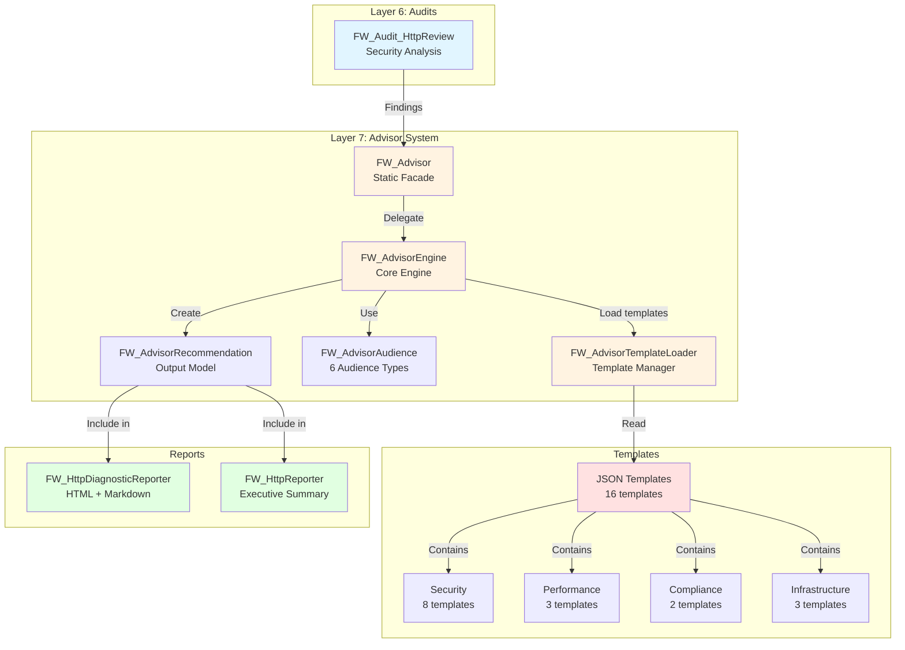
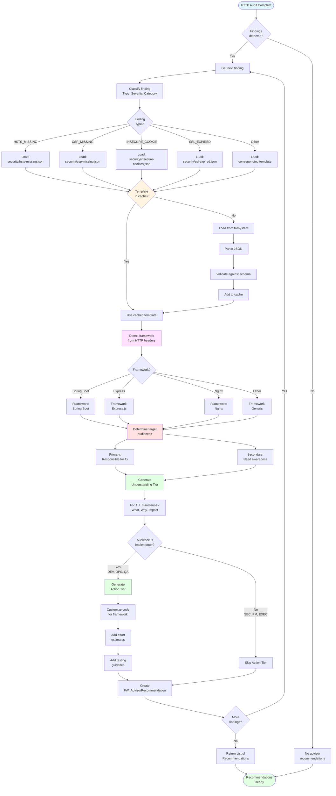
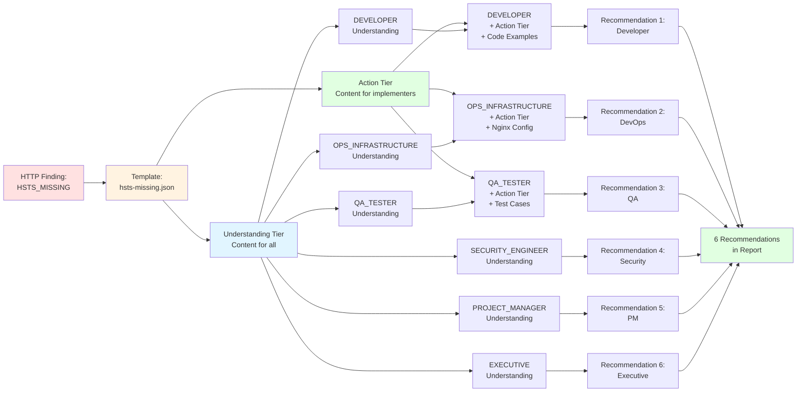
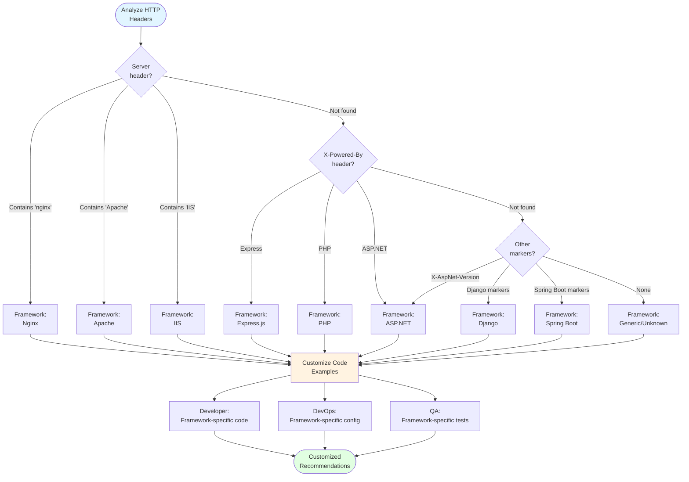
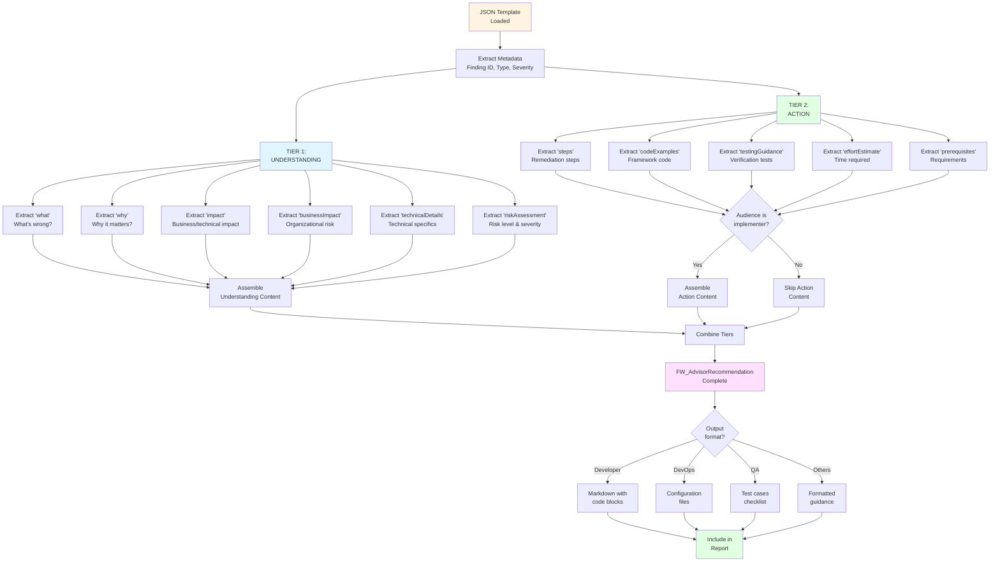
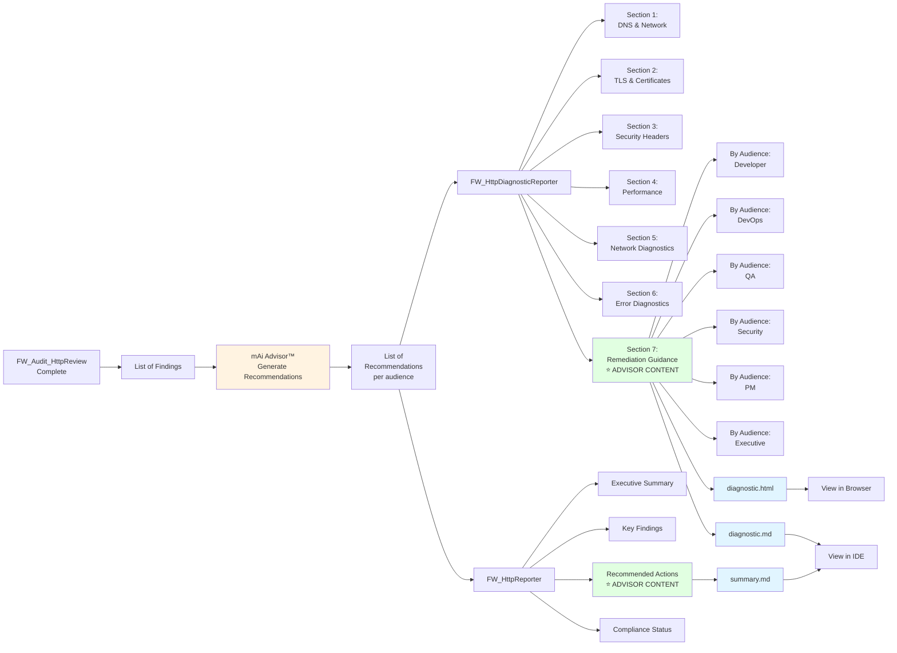

# Automation Framework - mAi Advisor™ Flow Diagram

<!-- ===============================================================
@file: Diagram-Advisor-Flow.md
@filepath: src/test/java/framework/.docs/Diagram-Advisor-Flow.md
@version: 1.0.0
@updated: 2025-10-30 01:15:00 PM CDT
@author: Greg Paskal
@company: MissionWares

@description:
Visual documentation of the mAi Advisor™ recommendation generation flow.
Shows the complete end-to-end process from HTTP audit execution through
finding detection, template matching, framework detection, and multi-audience
recommendation generation. Includes sequence diagrams for component interactions
and flowcharts for template selection logic.

@dependencies:
- Mermaid diagram rendering support
- framework.advisor.* (advisor components)
- framework.audits.FW_Audit_HttpReview
- framework.http.FW_HttpExecutor

@tags: diagrams, mAi-advisor, flow, sequence, recommendations, mAi™

@changeLog:
Date        Author          Version  Description
----------  --------------  -------  --------------------------
2025-10-30  G. Paskal       1.0.0    Initial advisor flow diagrams
=============================================================== -->

<!-- Navigation - Begin -->
[Home](Home.md) | [Overview](Doc-Overview.md) | [Setup](Doc-Setup.md) | [Test](Doc-Test-Development.md) | [Diagrams](Diagrams.md) | [API Docs](../../../../../target/site/index.html)
<!-- Navigation - End -->

---

# mAi Advisor™ Recommendation Flow

## Introduction

This document visualizes the complete flow of the mAi Advisor™ intelligent guidance system, from HTTP audit execution through multi-audience recommendation generation. Understanding this flow helps developers, QA engineers, and framework maintainers see how audit findings are transformed into actionable, role-specific guidance.

**Key Process Steps:**
1. HTTP audit execution and finding detection
2. Template matching based on finding type
3. Framework auto-detection from HTTP headers
4. Two-tier recommendation generation (Understanding + Action)
5. Multi-audience content customization
6. Report integration and delivery

---

## Complete Recommendation Generation Flow

This sequence diagram shows the end-to-end process from test execution to report delivery:

---

## Component Interaction Overview

This diagram shows how the main advisor components interact:

---

## Template Selection Logic

This flowchart shows how findings are matched to templates and processed:

---

## Multi-Audience Generation Process

This diagram shows how a single finding generates recommendations for all 6 audiences:

---

## Framework Detection Process

This diagram shows how the advisor detects application frameworks:

---

## Two-Tier Content Assembly

This diagram shows how Understanding and Action tiers are assembled:

---

## Report Integration Flow

This diagram shows how advisor recommendations are integrated into reports:

---

## Summary

The mAi Advisor™ system transforms raw HTTP audit findings into actionable, role-specific guidance through a sophisticated multi-stage process:

1. **Finding Detection** - HTTP audit identifies security, performance, and compliance issues
2. **Template Matching** - Each finding type maps to a pre-built JSON template
3. **Framework Detection** - HTTP headers reveal application technology stack
4. **Content Generation** - Two-tier model creates understanding (all) + action (implementers)
5. **Audience Targeting** - Recommendations customized for 6 different roles
6. **Report Integration** - Guidance embedded in comprehensive diagnostic reports

This intelligent system reduces remediation time by 50%+ by providing exactly the right information to exactly the right person at exactly the right time.

---

## Related Documentation

- [mAi Advisor™ Guide](Doc-mAi-Advisor.md) - Comprehensive advisor documentation
- [HTTP Security Assessment](Doc-HTTP-Assessment.md) - HTTP audit details
- [Architecture Overview](Diagram-Architecture.md) - Framework architecture
- [Diagrams Hub](Diagrams.md) - All framework diagrams
- [API Documentation](../../../../../target/site/index.html) - JavaDocs

---

**Version**: 1.0.0  
**Last Updated**: 2025-10-30 01:15:00 PM CDT  
**Copyright** © 2025 MissionWares. All Rights Reserved.