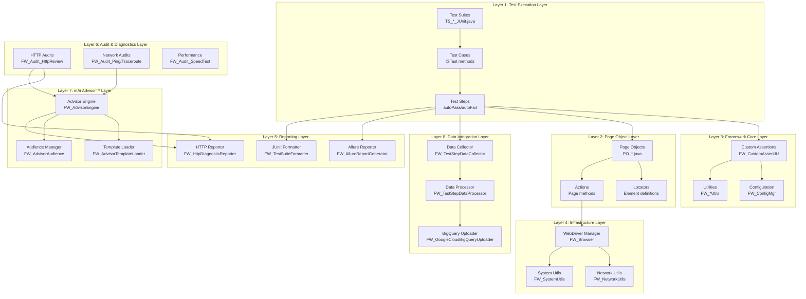
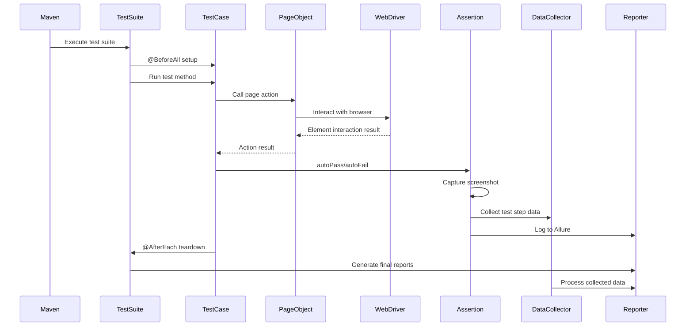
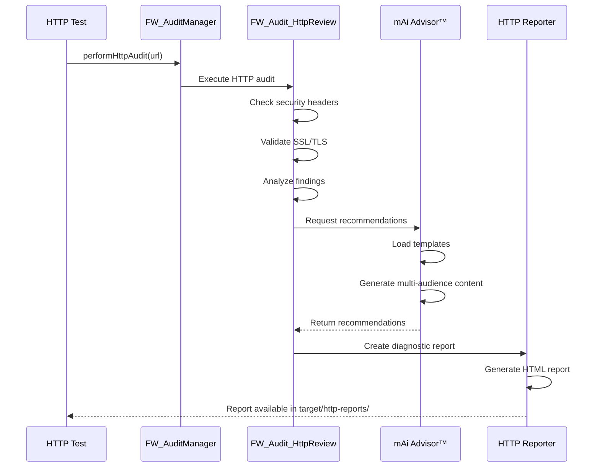
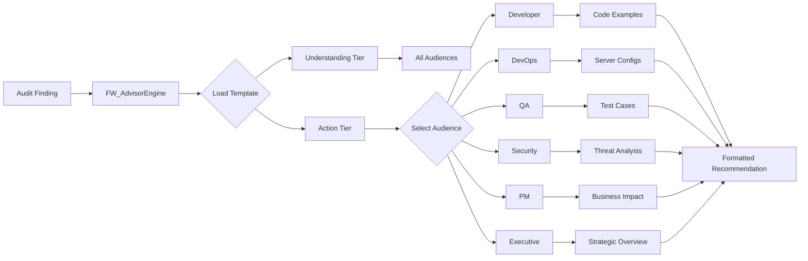
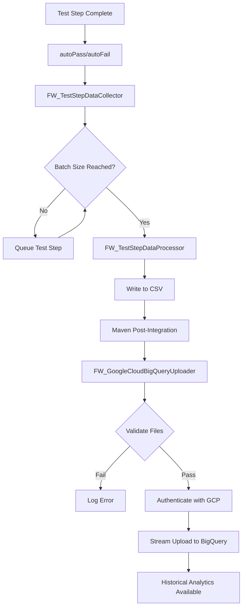

# Automation Framework - Diagram - Architecture

<!-- ===============================================================
@file: Diagram-Architecture.md
@filepath: src/test/java/framework/.docs/Diagram-Architecture.md
@version: 1.2.0
@updated: 2025-10-30 12:20:00 PM CDT
@author: Greg Paskal
@company: MissionWares

@description:
Comprehensive visual representation of the automation framework's 8-layer
architecture. This document illustrates the complete architectural design with
detailed Mermaid diagrams showing layer relationships, component interactions,
data flows, and integration points. Includes the test execution flow, HTTP
audit pipeline, mAi Advisor™ recommendation engine, and BigQuery data integration.
Essential for understanding the framework's modular design and extensibility.

@dependencies:
- Mermaid diagram rendering support
- All 8 architectural layers
- Related documentation: Doc-Overview.md, Doc-Setup.md, Doc-Test-Development.md

@tags: architecture, framework-design, layers, mermaid, documentation, mAi™

@changeLog:
Date        Author          Version  Description
----------  --------------  -------  --------------------------
2025-01-01  G. Paskal       1.0.0    Initial architecture diagram
2025-09-09  G. Paskal       1.1.0    Added mAi™ header and enhanced content
2025-10-30  G. Paskal       1.2.0    Complete rewrite with 8-layer architecture
=============================================================== -->

<!-- Navigation - Begin -->
[Home](Home.md) | [Overview](Doc-Overview.md) | [Setup](Doc-Setup.md) | [Test](Doc-Test-Development.md) | [Diagrams](Diagrams.md) | [API Docs](../../../../../target/site/index.html)
<!-- Navigation - End -->

---

## Description

This document provides a comprehensive visual representation of the automation framework's architecture. The framework follows an 8-layer modular design that promotes scalability, maintainability, and extensibility. Each layer has distinct responsibilities and well-defined interfaces for interaction with other layers.

## Framework Architecture Overview

The automation framework is built on a layered architecture that separates concerns and enables independent evolution of each layer. This design supports:

- **Modularity**: Each layer can be updated independently
- **Testability**: Layers can be tested in isolation
- **Scalability**: Easy to add new capabilities
- **Maintainability**: Clear separation of responsibilities
- **Extensibility**: Simple to integrate new tools and services

---

## 8-Layer Architecture Diagram

---

## Layer Descriptions

### Layer 1: Test Execution Layer
**Purpose**: Defines and executes automated test cases using JUnit 5

**Key Components**:
- **Test Suites** (`TS_*_JUnit.java`): Organize related test cases
- **Test Cases** (`@Test` methods): Individual test scenarios
- **Test Steps** (autoPass/autoFail): Granular test actions with validation

**Responsibilities**:
- Test suite organization and lifecycle management
- Test case execution and flow control
- Test step validation and assertion
- Integration with JUnit 5 annotations and lifecycle hooks

**Classes**: `TS_Authentication_JUnit`, `TS_Ordering_JUnit`, `TS_HttpAssessment_JUnit`, `TS_Network_JUnit`

---

### Layer 2: Page Object Layer
**Purpose**: Encapsulates page elements and interactions using Page Object Model pattern

**Key Components**:
- **Page Objects** (`PO_*.java`): Represent web pages as classes
- **Locators**: Element identification strategies (XPath, CSS, ID)
- **Actions**: Page-specific methods for user interactions

**Responsibilities**:
- UI element encapsulation and abstraction
- Page-level action methods
- Element wait strategies and synchronization
- Reusable page interaction patterns

**Classes**: `PO_Login`, `PO_Products`, `PO_Cart`, `PO_Checkout`, `PO_Common_Hamburger`

---

### Layer 3: Framework Core Layer
**Purpose**: Provides core utilities, assertions, and configuration management

**Key Components**:
- **Custom Assertions** (`FW_CustomAssertJU`): Enhanced assertions with screenshots
- **Configuration Manager** (`FW_ConfigMgr`): Centralized configuration
- **Utilities**: Date/time, strings, files, CSV, images, etc.

**Responsibilities**:
- Custom assertion logic with automatic screenshots
- Configuration property management
- Utility functions for common operations
- Cross-cutting concerns (logging, debugging)

**Classes**: `FW_CustomAssertJU`, `FW_ConfigMgr`, `FW_DateTimeUtils`, `FW_StringUtils`, `FW_FileDirUtils`, `FW_CSVUtils`

---

### Layer 4: Infrastructure Layer
**Purpose**: Manages WebDriver lifecycle and system-level operations

**Key Components**:
- **WebDriver Manager** (`FW_Browser`): Browser creation and disposal
- **Network Utilities** (`FW_NetworkUtils`): Network operations
- **System Utilities** (`FW_SystemUtils`): OS and environment operations

**Responsibilities**:
- WebDriver instance creation and configuration
- Browser lifecycle management
- Network connectivity and diagnostics
- System environment detection and configuration

**Classes**: `FW_Browser`, `FW_NetworkUtils`, `FW_SystemUtils`, `FW_PerformanceUtils`

---

### Layer 5: Reporting Layer
**Purpose**: Generates comprehensive test reports and execution summaries

**Key Components**:
- **Allure Reporter** (`FW_AllureReportGenerator`): Rich HTML reports
- **HTTP Reporter** (`FW_HttpDiagnosticReporter`): Security audit reports
- **JUnit Formatter** (`FW_TestSuiteFormatter`): Console output formatting

**Responsibilities**:
- Test execution report generation
- HTTP audit diagnostic reports
- Console output formatting and coloring
- Screenshot attachment to reports
- Historical trend analysis

**Classes**: `FW_AllureReportGenerator`, `FW_HttpDiagnosticReporter`, `FW_HttpReporter`, `FW_TestSuiteFormatter`, `FW_ReportUtils`

---

### Layer 6: Audit & Diagnostics Layer
**Purpose**: Performs security audits and network diagnostics

**Key Components**:
- **HTTP Audits** (`FW_Audit_HttpReview`): Security header validation
- **Network Audits** (`FW_Audit_Ping`, `FW_Audit_Traceroute`): Connectivity tests
- **Performance** (`FW_Audit_SpeedTest`): Bandwidth measurement

**Responsibilities**:
- HTTP security header auditing
- SSL/TLS certificate validation
- Network connectivity testing (ping, traceroute)
- Network performance measurement (speed tests)
- Protocol compliance verification

**Classes**: `FW_AuditManager`, `FW_Audit_HttpReview`, `FW_Audit_Ping`, `FW_Audit_Traceroute`, `FW_Audit_SpeedTest`

---

### Layer 7: mAi Advisor™ Layer
**Purpose**: Provides intelligent, context-aware recommendations for findings

**Key Components**:
- **Advisor Engine** (`FW_AdvisorEngine`): Recommendation generation logic
- **Template Loader** (`FW_AdvisorTemplateLoader`): JSON template management
- **Audience Manager** (`FW_AdvisorAudience`): Multi-audience content delivery

**Responsibilities**:
- Context-aware recommendation generation
- Multi-tier content delivery (Understanding + Action)
- Multi-audience targeting (Developer, DevOps, QA, Security, PM, Executive)
- Template-based recommendation system
- Integration with HTTP and network audits

**Classes**: `FW_Advisor`, `FW_AdvisorEngine`, `FW_AdvisorTemplateLoader`, `FW_AdvisorAudience`, `FW_AdvisorTemplate`, `FW_AdvisorFinding`, `FW_AdvisorRecommendation`

---

### Layer 8: Data Integration Layer
**Purpose**: Collects, processes, and uploads test data to cloud analytics

**Key Components**:
- **Data Collector** (`FW_TestStepDataCollector`): Test step data queueing
- **Data Processor** (`FW_TestStepDataProcessor`): CSV file generation
- **BigQuery Uploader** (`FW_GoogleCloudBigQueryUploader`): Cloud data upload

**Responsibilities**:
- Real-time test step data collection
- Batch processing and CSV generation
- Google BigQuery integration
- Historical test data analytics
- Cloud-based reporting and trends

**Classes**: `FW_TestStepDataCollector`, `FW_TestStepDataProcessor`, `FW_GoogleCloudBigQueryUploader`, `FW_GoogleCloudUtils`

---

## Component Interaction Flows

### Test Execution Flow

### HTTP Audit Pipeline Flow

### mAi Advisor™ Recommendation Flow

### Data Collection to BigQuery Flow

---

## Design Principles

The framework architecture adheres to these principles:

1. **Single Responsibility**: Each layer has one primary responsibility
2. **Dependency Inversion**: Layers depend on abstractions, not implementations
3. **Open/Closed**: Open for extension, closed for modification
4. **Interface Segregation**: Clients only depend on methods they use
5. **Don't Repeat Yourself (DRY)**: Reusable components across layers

---

## Layer Integration Points

### Test Layer → Page Object Layer
- Interface: Test cases call page object methods
- Data Flow: Test parameters → Page actions → Results

### Page Object Layer → Infrastructure Layer
- Interface: Page objects use WebDriver from FW_Browser
- Data Flow: Page elements → WebDriver commands → Browser

### Framework Core → All Layers
- Interface: All layers use utilities and configuration
- Data Flow: Configuration properties → Framework behavior

### Audit Layer → Advisor Layer
- Interface: Audits request recommendations for findings
- Data Flow: Finding details → Recommendation templates → Formatted advice

### Test Layer → Data Integration Layer
- Interface: Test steps automatically collect data
- Data Flow: Test results → CSV → BigQuery

---

## Extensibility Points

The framework supports extension at multiple points:

1. **New Test Suites**: Add new `TS_*_JUnit.java` files
2. **New Page Objects**: Create new `PO_*.java` classes
3. **Custom Utilities**: Add new `FW_*Utils.java` classes
4. **New Audit Types**: Implement new `FW_Audit_*.java` components
5. **Custom Reporters**: Create new report generators
6. **Advisor Templates**: Add new JSON recommendation templates

---

## Related Documentation

- [Framework Overview](Doc-Overview.md) - High-level framework introduction
- [Test Development Guide](Doc-Test-Development.md) - Writing tests
- [Test Execution Flow](Diagram-Maven-to-first-Test-Case.md) - Maven to test execution
- [Data Collection Pipeline](Diagram-Adding-data-to-datacollector.md) - Data flow details
- [BigQuery Integration](Diagram-Automation-completed-to-Google_BigData.md) - Cloud upload process
- [HTTP Assessment](Doc-HTTP-Assessment.md) - HTTP audit layer details
- [Network Diagnostics](Doc-Network-Diagnostics.md) - Network audit layer details
- [mAi Advisor™](Doc-mAi-Advisor.md) - Advisor layer details

---

**Version**: 1.2.0  
**Last Updated**: 2025-10-30 12:20:00 PM CDT  
**Copyright** © 2025 MissionWares. All Rights Reserved.