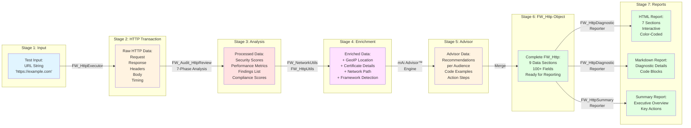
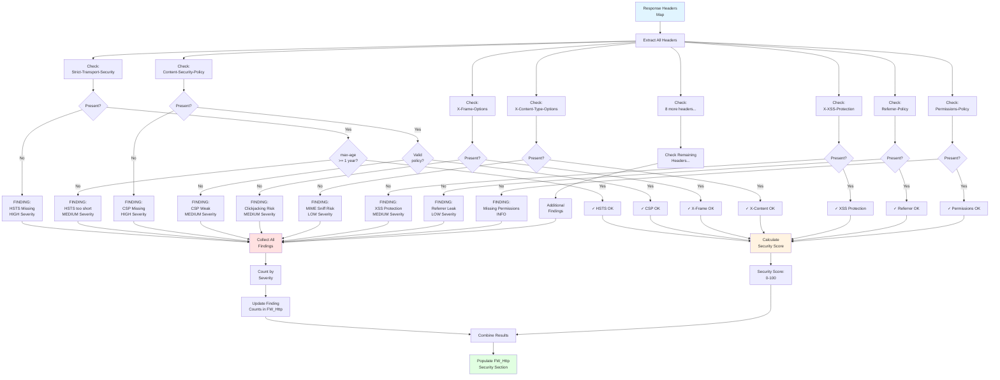
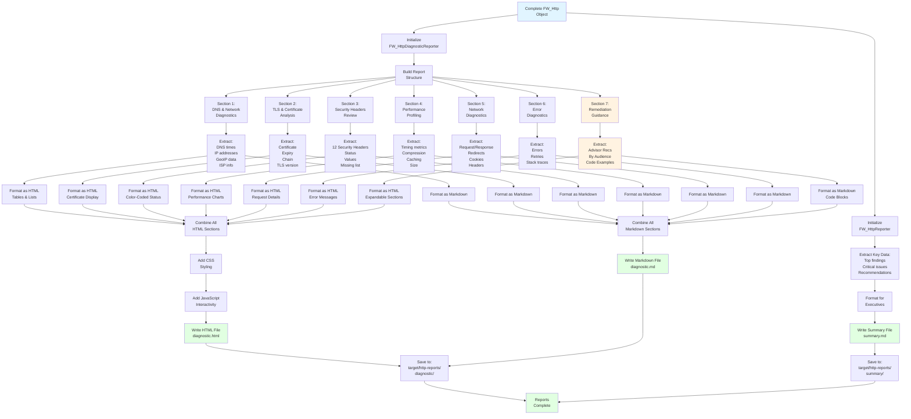
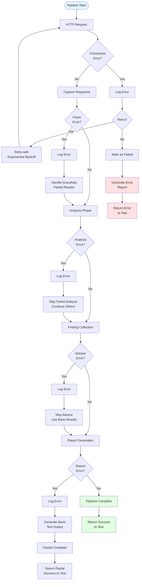
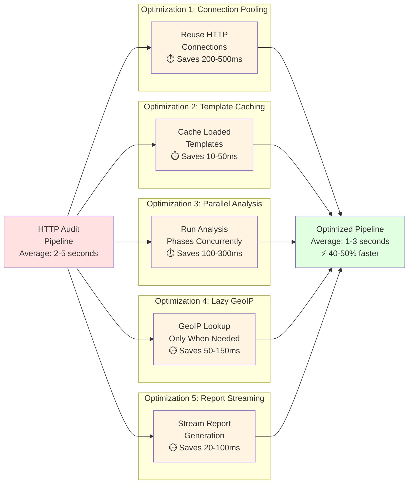

# Automation Framework - HTTP Audit Pipeline Diagram

<!-- ===============================================================
@file: Diagram-HTTP-Audit-Pipeline.md
@filepath: src/test/java/framework/.docs/Diagram-HTTP-Audit-Pipeline.md
@version: 1.0.0
@updated: 2025-10-30 01:21:00 PM CDT
@author: Greg Paskal
@company: MissionWares

@description:
Visual documentation of the complete HTTP audit pipeline from test execution
through report generation. Shows the full end-to-end process including HTTP
request/response capture, 7-phase security analysis, finding collection, mAi
Advisor™ recommendation generation, and comprehensive report assembly. Includes
flowcharts for data transformation at each stage and integration points.

@dependencies:
- Mermaid diagram rendering support
- framework.audits.FW_AuditManager
- framework.audits.FW_Audit_HttpReview
- framework.http.FW_HttpExecutor
- Report generators

@tags: diagrams, http-audit, pipeline, flow, reports, security, mAi™

@changeLog:
Date        Author          Version  Description
----------  --------------  -------  --------------------------
2025-10-30  G. Paskal       1.0.0    Initial HTTP audit pipeline diagrams
=============================================================== -->

<!-- Navigation - Begin -->
[Home](Home.md) | [Overview](Doc-Overview.md) | [Setup](Doc-Setup.md) | [Test](Doc-Test-Development.md) | [Diagrams](Diagrams.md) | [API Docs](../../../../../target/site/index.html)
<!-- Navigation - End -->

---

# HTTP Audit Pipeline

## Introduction

This document visualizes the complete HTTP audit pipeline, showing how a simple test command transforms into comprehensive security reports with actionable recommendations. Understanding this pipeline helps developers optimize test execution, troubleshoot issues, and extend the framework with custom analysis capabilities.

**Pipeline Stages:**
1. Test suite execution and initialization
2. HTTP request/response capture
3. 7-phase comprehensive analysis
4. Finding collection and scoring
5. mAi Advisor™ recommendation generation
6. Report assembly (diagnostic + summary)
7. Output delivery to filesystem

---

## Complete Pipeline Overview

This flowchart shows the entire HTTP audit pipeline from start to finish:

```mermaid
flowchart TD
    Start([Test Execution<br/>mvn test]) --> InitSuite[JUnit @BeforeAll<br/>Initialize Test Suite]
    
    InitSuite --> LoadConfig[FW_ConfigMgr<br/>Load testConfig.properties]
    LoadConfig --> InitTest[JUnit @Test<br/>Test Case Start]
    
    InitTest --> CallAudit[Call FW_AuditManager<br/>performHttpAudit]
    
    CallAudit --> AuditMgr{FW_AuditManager<br/>INSTANCE}
    
    AuditMgr --> GetReview[getAuditHttpReview]
    GetReview --> HttpReview[FW_Audit_HttpReview<br/>runAuditHttpReview]
    
    HttpReview --> InitHttp[Initialize<br/>FW_Http object]
    InitHttp --> CallExecutor[Call FW_HttpExecutor]
    
    CallExecutor --> HttpExec[FW_HttpExecutor.execute]
    
    rect rgb(220, 240, 255)
        Note over HttpExec: HTTP Transaction Capture
        HttpExec --> OpenConn[Open HTTP Connection]
        OpenConn --> SendReq[Send HTTP Request]
        SendReq --> CaptureTiming1[Capture DNS time]
        CaptureTiming1 --> CaptureTiming2[Capture Connection time]
        CaptureTiming2 --> CaptureTiming3[Capture TLS time]
        CaptureTiming3 --> ReceiveResp[Receive Response]
        ReceiveResp --> CaptureTiming4[Capture Response time]
        CaptureTiming4 --> ExtractHeaders[Extract Headers]
        ExtractHeaders --> ExtractCookies[Extract Cookies]
        ExtractCookies --> ExtractCert[Extract Certificate]
        ExtractCert --> StoreHttp[Store in FW_Http]
    end
    
    StoreHttp --> ReturnHttp[Return FW_Http]
    ReturnHttp --> StartAnalysis[Begin 7-Phase<br/>Analysis]
    
    rect rgb(255, 245, 220)
        Note over StartAnalysis: 7-Phase Security Analysis
        StartAnalysis --> Phase1[Phase 1:<br/>Network & Geolocation]
        Phase1 --> GeoIP[GeoIP Lookup]
        GeoIP --> DNSResolution[DNS Resolution]
        DNSResolution --> NetworkMetrics[Network Metrics]
        
        NetworkMetrics --> Phase2[Phase 2:<br/>TLS & Certificate]
        Phase2 --> ValidateCert[Validate Certificate]
        ValidateCert --> CheckExpiry[Check Expiration]
        CheckExpiry --> AnalyzeChain[Analyze Chain]
        AnalyzeChain --> CheckTLS[Check TLS Version]
        
        CheckTLS --> Phase3[Phase 3:<br/>Security Headers]
        Phase3 --> CheckHSTS[Check HSTS]
        CheckHSTS --> CheckCSP[Check CSP]
        CheckCSP --> CheckXFrame[Check X-Frame-Options]
        CheckXFrame --> Check11More[Check 9 more headers]
        
        Check11More --> Phase4[Phase 4:<br/>Cookie Security]
        Phase4 --> CheckSecure[Check Secure flag]
        CheckSecure --> CheckHttpOnly[Check HttpOnly]
        CheckHttpOnly --> CheckSameSite[Check SameSite]
        CheckSameSite --> CheckExpiry2[Check Expiration]
        
        CheckExpiry2 --> Phase5[Phase 5:<br/>Redirect Chain]
        Phase5 --> CountRedirects[Count Redirects]
        CountRedirects --> CheckLoop[Check for Loops]
        CheckLoop --> AnalyzeUpgrade[Analyze HTTP→HTTPS]
        
        AnalyzeUpgrade --> Phase6[Phase 6:<br/>Performance]
        Phase6 --> MeasureLatency[Measure Latency]
        MeasureLatency --> CheckCompression[Check Compression]
        CheckCompression --> CheckCache[Check Caching]
        CheckCache --> MeasureSize[Measure Size]
        
        MeasureSize --> Phase7[Phase 7:<br/>Compliance]
        Phase7 --> CalcOWASP[Calculate OWASP Score]
        CalcOWASP --> CalcPCI[Calculate PCI-DSS]
        CalcPCI --> CalcGDPR[Calculate GDPR]
    end
    
    CalcGDPR --> CollectFindings[Collect All Findings]
    CollectFindings --> CalcScores[Calculate Scores<br/>Security, Performance,<br/>Compliance]
    
    CalcScores --> PopulateHttp[Populate FW_Http<br/>with Results]
    PopulateHttp --> CountFindings[Count Findings<br/>by Severity]
    
    CountFindings --> TriggerAdvisor{Findings<br/>exist?}
    
    TriggerAdvisor -->|Yes| CallAdvisor[Call mAi Advisor™]
    TriggerAdvisor -->|No| SkipAdvisor[Skip Advisor]
    
    CallAdvisor --> GenRecs[Generate<br/>Recommendations<br/>for all audiences]
    GenRecs --> AddRecsToHttp[Add Recommendations<br/>to FW_Http]
    
    AddRecsToHttp --> MergeAdvisor[Merge Advisor Data]
    SkipAdvisor --> MergeAdvisor
    
    MergeAdvisor --> ReturnComplete[Return Complete<br/>FW_Http to Test]
    
    ReturnComplete --> GenReports{Generate<br/>Reports?}
    
    rect rgb(220, 255, 220)
        Note over GenReports: Report Generation
        GenReports -->|Yes| CreateDiag[FW_HttpDiagnosticReporter<br/>Create Diagnostic Report]
        
        CreateDiag --> BuildHTML[Build HTML Report]
        BuildHTML --> Section1[Section 1: DNS & Network]
        BuildHTML --> Section2[Section 2: TLS & Certificates]
        BuildHTML --> Section3[Section 3: Security Headers]
        BuildHTML --> Section4[Section 4: Performance]
        BuildHTML --> Section5[Section 5: Network Diagnostics]
        BuildHTML --> Section6[Section 6: Error Diagnostics]
        BuildHTML --> Section7[Section 7: Remediation<br/>⭐ Advisor Content]
        
        Section7 --> WriteHTML[Write HTML File]
        WriteHTML --> BuildMD[Build Markdown Report]
        BuildMD --> WriteMD[Write MD File]
        
        WriteMD --> CreateSum[FW_HttpReporter<br/>Create Summary]
        CreateSum --> ExecSum[Executive Summary]
        ExecSum --> KeyFindings[Key Findings]
        KeyFindings --> TopRecs[Top Recommendations<br/>⭐ Advisor Content]
        TopRecs --> WriteSummary[Write Summary File]
    end
    
    WriteSummary --> SaveReports[Save to<br/>target/http-reports/]
    GenReports -->|No| SkipReports[Skip Report Gen]
    
    SaveReports --> TestComplete[Test Step Complete]
    SkipReports --> TestComplete
    
    TestComplete --> ReturnResult[Return Test Result<br/>to JUnit]
    ReturnResult --> End([Test Execution<br/>Complete])
    
    style Start fill:#e1f5ff
    style End fill:#e1ffe1
    style CallAdvisor fill:#fff3e1
    style Section7 fill:#e1ffe1
    style TopRecs fill:#e1ffe1
```

---

## Data Transformation Pipeline

This diagram shows how data transforms at each stage:



---

## Security Header Analysis Flow

This detailed diagram shows the security header analysis process:



---

## Report Assembly Process

This diagram shows how comprehensive reports are assembled:



---

## Integration Points

This diagram shows key integration points where custom extensions can be added:

```mermaid
flowchart TB
    subgraph "Extension Point 1: Pre-Audit"
        EP1[Before HTTP Request<br/>Custom Headers<br/>Authentication<br/>Proxies]
    end
    
    subgraph "Extension Point 2: Post-Capture"
        EP2[After HTTP Response<br/>Custom Parsing<br/>Additional Metrics<br/>Data Extraction]
    end
    
    subgraph "Extension Point 3: Analysis Phase"
        EP3[During Analysis<br/>Custom Checks<br/>Additional Validators<br/>Domain Logic]
    end
    
    subgraph "Extension Point 4: Finding Processing"
        EP4[After Findings<br/>Custom Scoring<br/>Finding Filters<br/>Priority Rules]
    end
    
    subgraph "Extension Point 5: Advisor Integration"
        EP5[Recommendation Gen<br/>Custom Templates<br/>Additional Audiences<br/>Framework Detection]
    end
    
    subgraph "Extension Point 6: Report Generation"
        EP6[Report Assembly<br/>Custom Sections<br/>Additional Formats<br/>External Tools]
    end
    
    Pipeline[HTTP Audit<br/>Pipeline] --> EP1
    EP1 --> HttpExec[FW_HttpExecutor]
    HttpExec --> EP2
    EP2 --> Analysis[FW_Audit_HttpReview<br/>7-Phase Analysis]
    Analysis --> EP3
    EP3 --> Findings[Finding Collection]
    Findings --> EP4
    EP4 --> Advisor[mAi Advisor™]
    Advisor --> EP5
    EP5 --> Reports[Report Generation]
    Reports --> EP6
    EP6 --> Output[Final Output]
    
    style EP1 fill:#ffe1ff
    style EP2 fill:#ffe1ff
    style EP3 fill:#ffe1ff
    style EP4 fill:#ffe1ff
    style EP5 fill:#fff3e1
    style EP6 fill:#ffe1ff
    style Output fill:#e1ffe1
```



---

## Error Handling Flow

This diagram shows how errors are handled throughout the pipeline:



---

## Performance Optimization Points

This diagram highlights areas where performance can be optimized:



---

## Summary

The HTTP Audit Pipeline transforms a simple URL string into comprehensive security reports through a sophisticated 7-stage process:

1. **Capture** - HTTP request/response with complete timing data
2. **Analyze** - 7-phase security, performance, and compliance analysis
3. **Enrich** - GeoIP, certificate details, network path
4. **Detect** - Framework and technology stack identification
5. **Advise** - mAi Advisor™ generates role-specific recommendations
6. **Assemble** - Reports compiled with diagnostic details and guidance
7. **Deliver** - HTML, Markdown, and summary files saved to filesystem

The pipeline is designed for:
- **Speed** - Complete analysis in 2-5 seconds
- **Extensibility** - 6 integration points for custom logic
- **Reliability** - Graceful error handling at every stage
- **Completeness** - 100+ metrics across 9 data categories

---

## Related Documentation

- [HTTP Security Assessment](Doc-HTTP-Assessment.md) - Comprehensive audit guide
- [mAi Advisor™ Flow](Diagram-Advisor-Flow.md) - Recommendation generation
- [Architecture Overview](Diagram-Architecture.md) - Framework layers
- [Diagrams Hub](Diagrams.md) - All framework diagrams
- [API Documentation](../../../../../target/site/index.html) - JavaDocs

---

**Version**: 1.0.0  
**Last Updated**: 2025-10-30 01:21:00 PM CDT  
**Copyright** © 2025 MissionWares. All Rights Reserved.