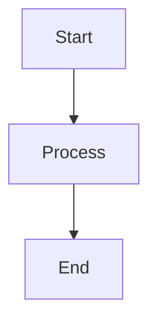
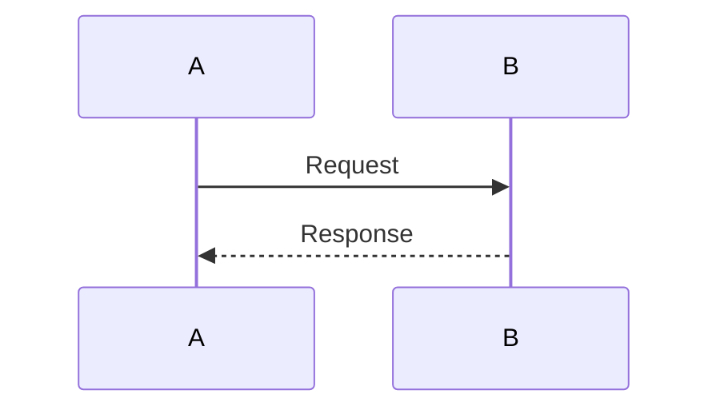
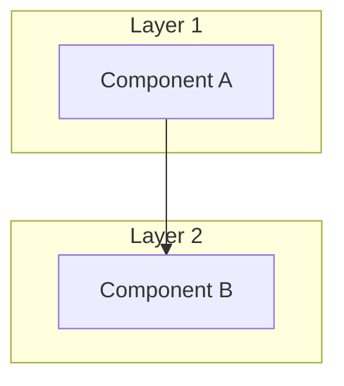

# Automation Framework - Diagrams Hub

<!-- ===============================================================
@file: Diagrams.md
@filepath: src/test/java/framework/.docs/Diagrams.md
@version: 1.1.0
@updated: 2025-10-30 01:45:00 PM CDT
@author: Greg Paskal
@company: MissionWares

@description:
Central hub page providing organized access to all framework architecture and
flow diagrams. This document serves as a visual documentation index, helping
developers quickly find the right diagram for their needs. Includes descriptions
of each diagram, suggested reading order, and a use case guide for determining
which diagram to consult for specific questions or tasks. Updated to reflect
BigQuery diagram v2.0.0 with comprehensive implementation details.

@dependencies:
- All diagram documentation files
- Mermaid diagram rendering support

@tags: diagrams, architecture, visual-documentation, navigation, hub, mAi™

@changeLog:
Date        Author          Version  Description
----------  --------------  -------  --------------------------
2025-10-30  G. Paskal       1.0.0    Initial diagrams hub page
2025-10-30  G. Paskal       1.1.0    Updated BigQuery diagram description to v2.0.0
=============================================================== -->

<!-- Navigation - Begin -->
[Home](Home.md) | [Overview](Doc-Overview.md) | [Setup](Doc-Setup.md) | [Test](Doc-Test-Development.md) | [Diagrams](Diagrams.md) | [API Docs](../../../../../target/site/index.html)
<!-- Navigation - End -->

---

# Visual Documentation Index

This page provides organized access to all framework diagrams and flowcharts. Each diagram is designed using Mermaid syntax for clear, interactive visualization of framework architecture, workflows, and data flows.

---

## 🆕 Recent Updates

### **BigQuery Upload Process - v2.0.0** (2025-10-30)
The BigQuery diagram has been completely rewritten to reflect the actual implementation:
- ✅ Fixed outdated methods (now shows OpenCSV implementation)
- ✅ Added dataset/table validation and creation flows
- ✅ Added archiving process documentation
- ✅ Enhanced from 121 lines to 900+ lines
- ✅ Comprehensive error handling guide
- ✅ Troubleshooting section with 6 common issues

[View updated diagram →](Diagram-Automation-completed-to-Google_BigData.md)

---

## Available Diagrams

### 🏗️ [Architecture Overview](Diagram-Architecture.md)
**Purpose**: Comprehensive view of the framework's 8-layer architecture

**What's Inside**:
- Complete 8-layer architecture diagram
- Layer-by-layer component breakdown
- Test execution flow sequence diagram
- HTTP audit pipeline flow
- mAi Advisor™ recommendation flow
- Data collection to BigQuery flow
- Design principles and extensibility points

**When to Use**:
- Understanding overall framework design
- Learning how layers interact
- Planning new feature additions
- Onboarding new team members
- Architecture reviews and discussions

**Key Concepts**: Layered architecture, component interactions, data flows, integration points

---

### 🚀 [Maven to First Test Case](Diagram-Maven-to-first-Test-Case.md)
**Purpose**: Complete execution path from Maven command to first test execution

**What's Inside**:
- Maven build lifecycle phases
- Surefire plugin initialization
- JUnit test suite discovery
- @BeforeAll and @BeforeEach hooks
- WebDriver creation sequence
- Page object instantiation
- Framework component initialization

**When to Use**:
- Understanding test execution lifecycle
- Debugging test startup issues
- Learning Maven integration
- Configuring test execution
- Troubleshooting initialization problems

**Key Concepts**: Maven phases, JUnit lifecycle, test initialization, framework bootstrap

---

### 🔍 [Test Assets Scanner](Diagram-TestAssetsScanner.md)
**Purpose**: Test suite discovery and metrics collection process

**What's Inside**:
- Maven Antrun plugin trigger
- FW_TestRunManager initialization
- Test suite file discovery
- Test case and method scanning
- Annotation processing (@Test, @BeforeAll, etc.)
- Test metrics calculation
- Pre-execution inventory reporting

**When to Use**:
- Understanding test discovery process
- Debugging missing tests
- Learning test counting logic
- Configuring test scanning
- Troubleshooting test detection

**Key Concepts**: Test discovery, reflection API, annotation processing, test inventory

---

### 📊 [Data Collection Pipeline](Diagram-Adding-data-to-datacollector.md)
**Purpose**: Test step data flow from execution to CSV storage

**What's Inside**:
- Test step completion trigger
- FW_CustomAssertJU assertion flow
- FW_TestStepDataCollector queueing
- Batch processing logic
- FW_TestStepDataProcessor CSV writing
- Thread-safe queue management
- Real-time vs batch modes

**When to Use**:
- Understanding data collection
- Debugging data loss issues
- Configuring batch sizes
- Learning CSV generation
- Troubleshooting data pipeline

**Key Concepts**: Data collection, queue management, batch processing, CSV generation

---

### ☁️ [BigQuery Upload Process](Diagram-Automation-completed-to-Google_BigData.md) 🆕 v2.0.0
**Purpose**: Complete post-test data pipeline from CSV to Google BigQuery

**What's Inside**:
- Maven post-integration-test trigger
- FW_GoogleCloudBigQueryUploader complete workflow
- Configuration validation (10+ properties)
- File validation (CSV, schema, credentials)
- Google Cloud authentication
- Dataset validation and creation
- Table validation and creation with time partitioning
- OpenCSV parsing and data transformation
- Batch insertion (FW_GoogleCloudUtils)
- Job monitoring with timeout
- CSV archiving with timestamps
- Comprehensive error handling (15+ scenarios)
- Troubleshooting guide (6 common issues)

**When to Use**:
- Understanding complete cloud integration pipeline
- Configuring BigQuery uploads
- Debugging upload failures
- Setting up service accounts and permissions
- Troubleshooting authentication or data issues
- Understanding OpenCSV implementation
- Learning error handling patterns

**Key Concepts**: Cloud integration, BigQuery, OpenCSV, batch insert, dataset management, archiving, error handling

**Version**: 2.0.0 - Complete rewrite with actual implementation (900+ lines)

---

## Suggested Reading Order

### For New Developers
Start with these to understand the framework:

1. **[Architecture Overview](Diagram-Architecture.md)** - Get the big picture
2. **[Maven to First Test Case](Diagram-Maven-to-first-Test-Case.md)** - See how tests run
3. **[Data Collection Pipeline](Diagram-Adding-data-to-datacollector.md)** - Understand data flow

### For Test Writers
Focus on test development and execution:

1. **[Maven to First Test Case](Diagram-Maven-to-first-Test-Case.md)** - Learn test lifecycle
2. **[Test Assets Scanner](Diagram-TestAssetsScanner.md)** - Understand test discovery
3. **[Architecture Overview](Diagram-Architecture.md)** - See available components

### For DevOps Engineers
Concentrate on integration and deployment:

1. **[Architecture Overview](Diagram-Architecture.md)** - System design overview
2. **[BigQuery Upload Process](Diagram-Automation-completed-to-Google_BigData.md)** - Cloud setup
3. **[Maven to First Test Case](Diagram-Maven-to-first-Test-Case.md)** - CI/CD integration

### For Framework Maintainers
Deep dive into all aspects:

1. **[Architecture Overview](Diagram-Architecture.md)** - Core design
2. **[Test Assets Scanner](Diagram-TestAssetsScanner.md)** - Discovery mechanics
3. **[Data Collection Pipeline](Diagram-Adding-data-to-datacollector.md)** - Data handling
4. **[Maven to First Test Case](Diagram-Maven-to-first-Test-Case.md)** - Execution flow
5. **[BigQuery Upload Process](Diagram-Automation-completed-to-Google_BigData.md)** - Cloud integration

---

## Use Case Guide

**"How does the framework execute tests?"**
→ [Maven to First Test Case](Diagram-Maven-to-first-Test-Case.md)

**"What is the overall architecture?"**
→ [Architecture Overview](Diagram-Architecture.md)

**"How does test discovery work?"**
→ [Test Assets Scanner](Diagram-TestAssetsScanner.md)

**"How is test data collected?"**
→ [Data Collection Pipeline](Diagram-Adding-data-to-datacollector.md)

**"How does data get to BigQuery?"**
→ [BigQuery Upload Process](Diagram-Automation-completed-to-Google_BigData.md)

**"How do the layers interact?"**
→ [Architecture Overview](Diagram-Architecture.md) - Component Interaction section

**"What happens in @BeforeAll and @BeforeEach?"**
→ [Maven to First Test Case](Diagram-Maven-to-first-Test-Case.md)

**"How are test metrics calculated?"**
→ [Test Assets Scanner](Diagram-TestAssetsScanner.md)

**"How does batch processing work?"**
→ [Data Collection Pipeline](Diagram-Adding-data-to-datacollector.md)

**"How do I configure Google Cloud integration?"**
→ [BigQuery Upload Process](Diagram-Automation-completed-to-Google_BigData.md)

---

## Diagram Technologies

All diagrams in this framework use **Mermaid** syntax for:
- ✅ Version control friendly (text-based)
- ✅ Renders in GitHub, GitLab, VS Code
- ✅ Easy to update and maintain
- ✅ Interactive in supported viewers
- ✅ Exports to PNG/SVG/PDF

### Viewing Diagrams

**GitHub/GitLab**: Diagrams render automatically in Markdown preview

**VS Code**: Install "Markdown Preview Mermaid Support" extension

**IntelliJ/WebStorm**: Built-in Mermaid support in Markdown preview

**CLI**: Use `mmdc` (mermaid-cli) to export to images

---

## Creating New Diagrams

When adding new diagrams to the framework:

1. **Follow naming convention**: `Diagram-<Topic>.md`
2. **Include mAi™ header**: Use standard file header format
3. **Add navigation**: Include nav bar at top
4. **Use Mermaid syntax**: flowchart, sequenceDiagram, or graph
5. **Update this hub**: Add new diagram to this index
6. **Cross-reference**: Link from related docs

### Diagram Templates

**Flowchart (Top-to-Bottom)**:

**Sequence Diagram**:

**Architecture Graph**:

---

## Related Documentation

- [Framework Overview](Doc-Overview.md) - High-level introduction
- [Test Development Guide](Doc-Test-Development.md) - Writing tests
- [Setup Instructions](Doc-Setup.md) - Installation and configuration
- [Test Execution Guide](Doc-Test-Execution-VSCode.md) - Running tests
- [API Documentation](../../../../../target/site/index.html) - JavaDocs

---

## Contributing Diagrams

To propose new diagrams or improvements:

1. Identify documentation gap or complex workflow
2. Create diagram using Mermaid syntax
3. Follow existing diagram structure and format
4. Include clear description and use cases
5. Test rendering in multiple viewers
6. Submit for review

**Good diagram candidates**:
- Complex workflows with multiple decision points
- Component interactions spanning multiple layers
- Data transformation pipelines
- Integration with external systems
- Multi-step configuration processes

---

**Version**: 1.0.0  
**Last Updated**: 2025-10-30 12:35:00 PM CDT  
**Copyright** © 2025 MissionWares. All Rights Reserved.