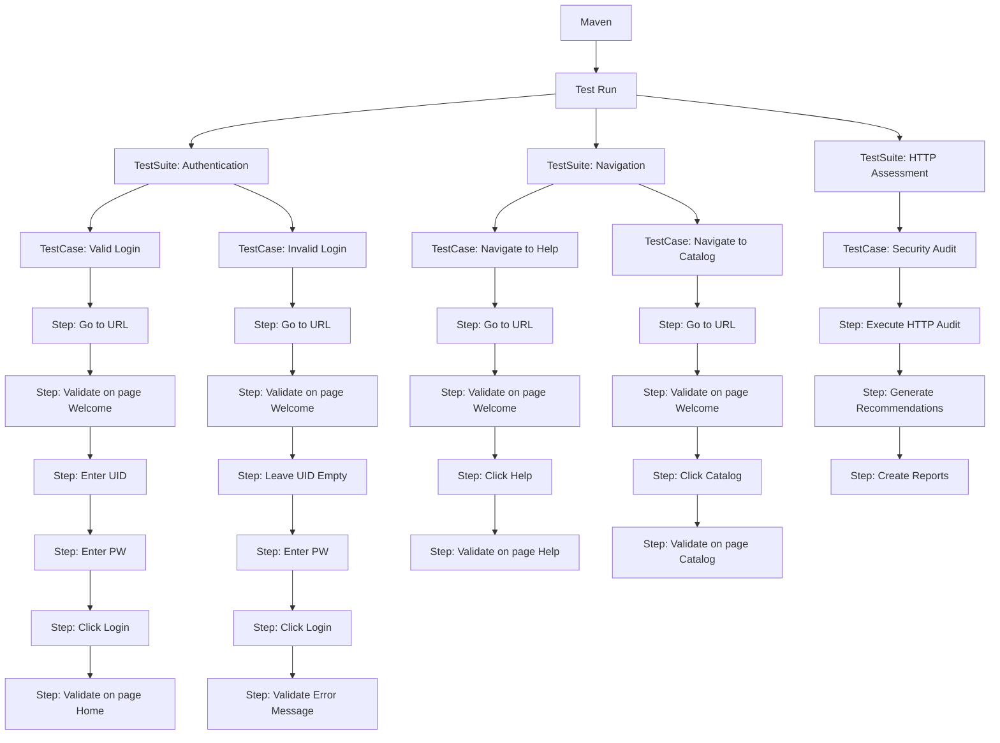

# Automation Framework - Overview

<!-- ===============================================================
@file: Doc-Overview.md
@filepath: src/test/java/framework/.docs/Doc-Overview.md
@version: 1.2.0
@updated: 2025-10-30 11:42:00 AM CDT
@author: Greg Paskal
@company: MissionWares

@description:
Comprehensive overview of the automation framework architecture and capabilities.
This document provides an introduction to the framework's core features, architectural
design, and test hierarchy. It serves as the primary entry point for developers
to understand the framework's structure, technology stack, and extensibility model.
Includes visual representation of the test execution hierarchy from Maven through
individual test steps and comprehensive documentation of all framework layers
including mAi Advisor™, HTTP Security Assessment, and Network Diagnostics.

@dependencies:
- JUnit 5 (Jupiter)
- Selenium 4 WebDriver
- Maven build system
- Page Object Model pattern
- Mermaid diagram rendering

@tags: overview, architecture, framework, documentation, test-hierarchy, mAiâ„¢

@changeLog:
Date        Author          Version  Description
----------  --------------  -------  --------------------------
2025-01-01  G. Paskal       1.0.0    Initial framework overview
2025-09-09  G. Paskal       1.1.0    Added mAiâ„¢ header and enhanced content
2025-10-30  G. Paskal       1.2.0    Added 3 layers, 60+ components, advanced features
=============================================================== -->

<!-- Navigation - Begin -->
[Home](Home.md) | [Overview](Doc-Overview.md) | [Setup](Doc-Setup.md) | [Test](Doc-Test-Development.md) | [Diagrams](Diagrams.md) | [API Docs](../../../../../target/site/index.html)
<!-- Navigation - End -->

---

# Overview

The automation framework is the workhorse of this toolset. It performs the actual actions and interactions with the application under test, providing a robust and scalable solution for automated testing with intelligent recommendation capabilities and comprehensive security assessment.

## Core Features

- **mAi Advisor™** intelligent recommendation engine with multi-audience guidance
- **HTTP Security Auditing** with automated vulnerability detection
- **Network Diagnostics** for connectivity and performance validation
- **JUnit 5** based automated test cases with modern assertions
- **Page Object Model (POM)** for maintainable page element organization
- **Maven** based dependency and execution management
- **Selenium 4** using WebDriver for browser automation
- **Built for extensibility** with modular component design
- **Cloud integration** with Google BigQuery for test analytics
- **Comprehensive reporting** via Allure Report framework
- **Cross-browser support** for Chrome, Firefox, Safari, and Edge

## Framework Architecture

The framework is designed with a modular, layered architecture that promotes:
- **Separation of Concerns**: Clear boundaries between test logic and implementation
- **Reusability**: Shared components and utilities across test suites
- **Maintainability**: Easy updates when application changes
- **Scalability**: Support for growing test suites and parallel execution
- **Extensibility**: Simple addition of new features and integrations
- **Intelligence**: Automated guidance through mAi Advisor™ recommendation engine

### Architecture Layers

The framework comprises 8 distinct architectural layers, each with specific responsibilities:

1. **Test Layer**: JUnit 5 test suites and test cases with execution lifecycle management
2. **Page Object Layer**: Encapsulated page interactions following POM design pattern
3. **Advisor Layer**: mAi™ intelligent recommendation engine (7 classes, 16+ templates)
4. **Auditing Layer**: HTTP security assessment and compliance validation (6 classes)
5. **Network Layer**: Connection testing and diagnostic tools (4 classes)
6. **Framework Core**: Utilities, assertions, and data management (19 utility classes)
7. **Infrastructure Layer**: WebDriver management, configuration, and browser automation
8. **Reporting Layer**: Test results, analytics, and cloud integration (Allure, BigQuery)

## Test Execution Hierarchy

The following diagram illustrates the complete hierarchy from Maven initiation through individual test step execution:

## Key Components

### Test Management
- **FW_TestRunManager**: Orchestrates test execution lifecycle and coordinates suite execution
- **FW_TestRunTracker**: Singleton pattern for tracking test metrics across runs
- **FW_TestSuite**: Test suite metadata, organization, and discovery
- **FW_TestCase**: Individual test case management and execution tracking
- **FW_TestStep**: Granular test step tracking with timestamps and results

### mAi Advisor™ System
- **FW_Advisor**: Main advisor interface and factory for recommendation generation
- **FW_AdvisorEngine**: Core recommendation generation engine with template matching
- **FW_AdvisorTemplateLoader**: JSON template management and validation
- **FW_AdvisorTemplate**: Template data structure with two-tier content model
- **FW_AdvisorAudience**: Multi-audience targeting (6 audience types)
- **FW_AdvisorRecommendation**: Generated recommendation object with audience-specific content
- **FW_AdvisorFinding**: HTTP audit finding wrapper for advisor integration

**Template Library**:
- **Security Templates** (8): SSL/TLS, CSP, HSTS, Cookie Security, HTTPS, Permissions Policy, Referrer Policy, X-Frame-Options
- **Performance Templates** (3): Compression, Caching, Response Time
- **Compliance Templates** (2): GDPR, PCI-DSS
- **Infrastructure Templates** (2): Server Configuration, DNS

### HTTP Security Auditing
- **FW_AuditManager**: Audit orchestration, execution control, and result aggregation
- **FW_Audit_HttpReview**: HTTP security header validation and analysis
- **FW_HttpExecutor**: HTTP request execution with detailed metrics capture
- **FW_Http**: HTTP transaction data object with request/response details
- **FW_HttpDiagnosticReporter**: HTML diagnostic report generation with findings
- **FW_HttpReporter**: Summary statistics and overview reports

### Network Diagnostics
- **FW_Audit_Ping**: ICMP ping testing with packet loss and latency metrics
- **FW_Traceroute**: Network route tracing with hop-by-hop analysis
- **FW_SpeedTest**: Bandwidth measurement for upload/download performance
- **FW_NetworkDetails**: Comprehensive network metadata and configuration capture

### Page Objects
- **PO_Login**: Login page interactions and authentication flows
- **PO_Products**: Product listing page with search and filter interactions
- **PO_Cart**: Shopping cart functionality and item management
- **PO_Checkout**: Checkout process with form handling
- **PO_Checkout_Overview**: Order review and confirmation
- **PO_Thank_You**: Order completion and confirmation messaging
- **PO_Common_Hamburger**: Navigation menu and sidebar interactions

### Core Utilities (19 Classes)
- **FW_CustomAssertJU**: Enhanced assertions with automatic screenshot capture
- **FW_ConfigMgr**: Configuration management and property file handling
- **FW_DateTimeUtils**: UTC timestamp standardization and time zone handling
- **FW_GoogleCloudUtils**: Google Cloud service integration (BigQuery, Storage)
- **FW_GoogleSheetUtils**: Google Sheets API integration for data export
- **FW_CSVUtils**: CSV file operations for data export and import
- **FW_HttpUtils**: HTTP operations and request/response handling
- **FW_NetworkUtils**: Network operations and connectivity validation
- **FW_StringUtils**: String manipulation and formatting utilities
- **FW_NumberUtils**: Number formatting and validation utilities
- **FW_FileDirUtils**: File system operations and directory management
- **FW_ImageUtils**: Image processing and manipulation utilities
- **FW_ScreenUtils**: Screenshot capture and image saving
- **FW_TestStepUtils**: Test step processing and data extraction
- **FW_JUnitUtils**: JUnit integration and test discovery utilities
- **FW_ReportUtils**: Report generation and formatting utilities
- **FW_DebugUtils**: Debug logging and diagnostic output
- **FW_ConsoleColors**: Terminal color output for enhanced readability
- **FW_SystemUtils**: System information and environment detection
- **FW_PerformanceUtils**: Performance metrics and timing utilities
- **FW_MarkdownUtils**: Markdown generation for documentation and reports

### Data Pipeline
- **FW_TestStepDataCollector**: Collects test step data during execution
- **FW_TestStepDataProcessor**: Processes and transforms collected data
- **FW_CSVWriterUtil**: Writes test data to CSV files
- **FW_GoogleCloudBigQueryUploader**: Uploads test data to BigQuery for analytics

## Advanced Features

### mAi Advisor™ Intelligent Recommendations

The mAi Advisor™ system provides context-aware recommendations tailored to six distinct audiences:

**Audience Types**:
1. **Executive**: Business risk, compliance impact, strategic priorities
2. **Project Manager**: Timeline impact, effort estimates, dependencies
3. **Developer**: Technical implementation, code examples, frameworks
4. **DevOps/Ops**: Infrastructure changes, server configs, deployment steps
5. **QA Tester**: Test implications, validation steps, automated tests
6. **Security Engineer**: Vulnerability details, attack vectors, threat levels

**Two-Tier Model**:
- **Understanding Tier**: Explains what's wrong and why it matters (all audiences)
- **Action Tier**: Provides step-by-step implementation guidance (implementers only)

**Framework Detection**:
- Spring Boot (Java)
- Express.js (Node.js)
- ASP.NET Core (C#)
- Nginx (Web Server)
- Apache (Web Server)
- Generic/Fallback patterns

### HTTP Security Assessment

**Audit Capabilities**:
- 12+ security header validation (CSP, HSTS, X-Frame-Options, etc.)
- SSL/TLS certificate inspection and expiration checking
- Cookie security analysis (HttpOnly, Secure, SameSite)
- Performance metrics (response time, compression, caching)
- Compliance validation (GDPR, PCI-DSS)

**Report Generation**:
- HTML diagnostic reports with color-coded findings
- Summary statistics and overview reports
- Automatic mAi Advisor™ recommendations for each finding
- Exportable results for compliance documentation

### Network Diagnostics

**Testing Capabilities**:
- **Ping**: Connectivity validation with packet loss and latency metrics
- **Traceroute**: Network path analysis with hop-by-hop response times
- **Speed Test**: Bandwidth measurement for performance baselining
- **Network Details**: System configuration and network metadata capture

## Benefits

- **Intelligent Guidance**: mAi Advisor™ provides context-aware recommendations for every finding
- **Security First**: Automated HTTP security audits identify vulnerabilities before deployment
- **Reduced Maintenance**: Page Object pattern isolates UI changes from test logic
- **Faster Development**: Reusable components and utilities accelerate test creation
- **Better Reporting**: Detailed test execution metrics with visual dashboards
- **Cloud Analytics**: BigQuery integration for historical analysis and trending
- **CI/CD Ready**: Maven integration for seamless pipeline automation
- **Multi-Audience**: Recommendations tailored to 6 different audience types

## Getting Started

1. Review the [Setup Guide](Doc-Setup.md) for installation instructions
2. Understand [Test Development](Doc-Test-Development.md) for writing tests
3. Learn about [Test Execution](Doc-Test-Execution-VSCode.md) for running tests
4. Explore the [Architecture Diagrams](Diagrams.md) for visual understanding
5. Try [HTTP Security Assessment](Doc-HTTP-Assessment.md) for automated audits
6. Experiment with [mAi Advisor™](Doc-mAi-Advisor.md) for intelligent recommendations

## Related Documentation

- [Technology Stack](../../../.docs/Technology-Stack.md)
- [Project Info](../../../.docs/info.md)
- [API Documentation](../../../../../target/site/index.html)
- [Architecture Diagrams](Diagram-Architecture.md)
- [Maven to Test Case](Diagram-Maven-to-first-Test-Case.md)
- [Data Pipeline](Diagram-Adding-data-to-datacollector.md)