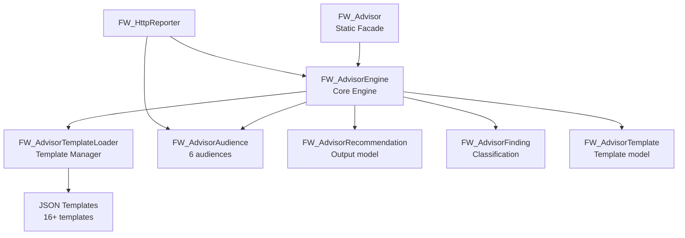

# Automation Framework - mAi Advisor™ Documentation

<!-- ===============================================================
@file: Doc-mAi-Advisor.md
@filepath: src/test/java/framework/.docs/Doc-mAi-Advisor.md
@version: 1.1.0
@updated: 2025-11-03 05:15:00 PM CDT
@author: Greg Paskal
@company: MissionWares

@description:
Comprehensive guide to the mAi Advisor™ intelligent guidance system - the
framework's capability that transforms HTTP audit findings into actionable,
audience-specific recommendations. Documents the two-tier architecture 
(Understanding + Action), six audience types, JSON template system, framework
detection, and integration patterns. Essential for understanding how the advisor
generates tailored recommendations for developers, DevOps, QA, security engineers,
project managers, and executives.

UPDATED: Added Priority 8 features - Audience Configuration in HTTP Reports,
integration with FW_HttpReporter, explanation of "0 recommendations"
behavior, and best practices for audience selection in reporting context.

@dependencies:
- framework.advisor.* (7 core classes)
- JSON template files in src/test/java/framework/advisor/templates/
- FW_Audit_HttpReview integration
- FW_HttpReporter integration (NEW in v2.2.0)
- Framework configuration (advisor-config.properties)

@tags: advisor, mAi™, guidance, recommendations, multi-audience, actionable

@changeLog:
Date        Author          Version  Description
----------  --------------  -------  --------------------------
2025-10-30  G. Paskal       1.0.0    Initial comprehensive advisor documentation
2025-11-03  G. Paskal       1.1.0    Added Priority 8: Audience config in HTTP reports
=============================================================== -->

<!-- Navigation - Begin -->
[Home](Home.md) | [Overview](Doc-Overview.md) | [Setup](Doc-Setup.md) | [Test](Doc-Test-Development.md) | [Diagrams](Diagrams.md) | [API Docs](../../../../../target/site/index.html)
<!-- Navigation - End -->

---

# mAi Advisor™ - Intelligent Guidance System

## Introduction

### What is mAi Advisor™?

**mAi Advisor™** is an intelligent guidance system that automatically transforms HTTP audit findings into actionable, role-specific recommendations. Rather than providing generic security reports, the advisor generates tailored guidance for six different audiences within your organization.

**Tagline:** *"Not just findings—Intelligent guidance for every role."*

### Why mAi Advisor™ Exists

Traditional audit reports provide excellent data about security issues but lack actionable guidance tailored to specific roles. Consider this scenario:

**Traditional Report:**
- Finding: "Missing HSTS header"
- Severity: High
- Impact: Users vulnerable to protocol downgrade attacks
- **What now?** → Everyone figures it out on their own

**With mAi Advisor™:**
- **Developer**: Gets Spring Boot code example to add HSTS header
- **DevOps**: Gets Nginx configuration to enforce HTTPS
- **QA**: Gets test cases to verify HSTS implementation
- **Security**: Gets threat analysis and compliance requirements
- **PM**: Gets business impact and sprint planning estimates
- **Executive**: Gets risk summary and strategic recommendations

### When to Use mAi Advisor™

mAi Advisor™ automatically activates during HTTP security assessments and can be invoked manually:

**Automatic Activation:**
- During HTTP audit execution via `TS_HttpAssessment_JUnit`
- Findings automatically generate recommendations
- Reports include advisor guidance for configured audience

**Manual Invocation:**
- Standalone recommendation generation
- Custom audience targeting
- Integration with external audit tools

**Audience-Specific Reports (NEW in v2.2.0):**
- Configure target audience via `FW_HttpReporter`
- Generate role-specific reports from single audit
- 6 audience types × 3 depth levels = 18 report configurations

---

## Architecture Overview

mAi Advisor™ consists of 7 core components working together to deliver intelligent guidance.

### Core Components

1. **FW_Advisor.java** - Static facade API for easy integration
2. **FW_AdvisorEngine.java** - Core processing engine
3. **FW_AdvisorTemplateLoader.java** - JSON template management
4. **FW_AdvisorAudience.java** - Audience taxonomy enumeration
5. **FW_AdvisorRecommendation.java** - Recommendation data model
6. **FW_AdvisorTemplate.java** - Template data structure
7. **FW_AdvisorFinding.java** - Finding classification model

### Component Relationships



### JSON Template System

Templates are stored in `src/test/java/framework/advisor/templates/` organized by category:

```
templates/
├── security/         (8 templates)
│   ├── hsts-missing.json
│   ├── csp-missing.json
│   ├── ssl-expired.json
│   └── ...
├── performance/      (3 templates)
├── compliance/       (2 templates)
└── infrastructure/   (3 templates)
```

Each template follows a strict JSON schema with validation rules ensuring consistent structure and quality.

---

## Two-Tier Recommendation Model

mAi Advisor™ uses a two-tier system to deliver appropriate content to each audience.

### Tier 1: UNDERSTANDING (All Audiences)

**Purpose**: Explain what's wrong and why it matters

**Content Includes:**
- **What**: Clear description of the finding
- **Why**: Explanation of why this matters
- **Impact**: Business and technical consequences
- **Risk**: Severity in audience-appropriate terms

**Example (HSTS Missing):**
```
Developer:
  What: HTTP Strict Transport Security (HSTS) header not configured
  Why: Browsers won't automatically upgrade HTTP to HTTPS
  Impact: Users vulnerable to man-in-the-middle attacks
  Risk: HIGH - Production security vulnerability

Executive:
  What: Website missing critical security protection
  Why: User data and credentials at risk during transmission
  Impact: Regulatory compliance risk, potential data breach
  Risk: HIGH - Immediate attention required
```

### Tier 2: ACTION (Implementers Only)

**Purpose**: Provide step-by-step remediation guidance

**Implementers** (receive ACTION tier):
- **DEVELOPER** - Code examples, testing procedures
- **OPS_INFRASTRUCTURE** - Server configs, deployment steps
- **QA_TESTER** - Test cases, validation procedures

**Coordinators** (UNDERSTANDING only):
- **SECURITY_ENGINEER** - Threat analysis, compliance requirements
- **PROJECT_MANAGER** - Business impact, resource planning
- **EXECUTIVE** - Strategic overview, risk assessment

**ACTION Tier Content:**
- Step-by-step instructions
- Framework-specific code examples
- Configuration templates
- Testing procedures
- Verification steps
- Effort estimates
- Sprint planning data

**Example (Developer ACTION tier):**
```java
// Spring Boot - Add HSTS header
@Configuration
public class SecurityConfig extends WebSecurityConfigurerAdapter {
    @Override
    protected void configure(HttpSecurity http) throws Exception {
        http.headers()
            .httpStrictTransportSecurity()
            .maxAgeInSeconds(31536000)
            .includeSubDomains(true);
    }
}

// Testing
@Test
public void testHSTSHeaderPresent() {
    HttpResponse response = makeRequest("/");
    assertNotNull(response.getHeader("Strict-Transport-Security"));
}
```

---

## Six Audience Types

### 1. DEVELOPER
**Role**: Software Engineer / Developer  
**Implementer**: Yes (receives ACTION tier)

**Understanding Tier Focus:**
- Technical explanation of vulnerability
- Code-level impact analysis
- Development workflow implications

**Action Tier Provides:**
- Framework-specific code examples (Spring Boot, Express, Django, etc.)
- Unit and integration test cases
- Code review checklist
- IDE integration guidance
- Commit message templates

**Example Topics:**
- "Add CSP header to Spring Boot application"
- "Implement secure cookie handling in Node.js"
- "Configure HSTS in Django middleware"

**HTTP Report Context (NEW):**
- Default audience for `FW_HttpReporter`
- Receives most detailed technical recommendations
- Best for daily development work and code reviews

---

### 2. OPS_INFRASTRUCTURE (DevOps)
**Role**: Operations / Infrastructure Engineer  
**Implementer**: Yes (receives ACTION tier)

**Understanding Tier Focus:**
- Infrastructure-level vulnerabilities
- Production environment risks
- Deployment and scaling concerns

**Action Tier Provides:**
- Server configuration templates (Nginx, Apache, IIS)
- Load balancer setup
- SSL/TLS certificate management
- Deployment automation scripts
- Monitoring and alerting configuration

**Example Topics:**
- "Configure HSTS in Nginx reverse proxy"
- "Set up SSL termination at load balancer"
- "Automate certificate renewal with Let's Encrypt"

**HTTP Report Context (NEW):**
- Use for deployment planning and operations
- Includes server-side configurations
- Best for production deployment scenarios

---

### 3. QA_TESTER
**Role**: Quality Assurance Engineer / Tester  
**Implementer**: Yes (receives ACTION tier)

**Understanding Tier Focus:**
- Testability of security fixes
- Validation requirements
- Regression risk areas

**Action Tier Provides:**
- Manual test procedures
- Automated test scripts
- Verification checklists
- Edge case scenarios
- Performance testing guidance

**Example Topics:**
- "Test HSTS header presence and configuration"
- "Verify CSP policy doesn't break functionality"
- "Validate secure cookie attributes"

**HTTP Report Context (NEW):**
- Use for test planning and validation
- Includes test cases and procedures
- Best for QA validation workflows

---

### 4. SECURITY_ENGINEER
**Role**: Security / InfoSec Specialist  
**Implementer**: No (UNDERSTANDING tier only)

**Understanding Tier Focus:**
- Threat analysis and attack vectors
- Compliance requirements (OWASP, PCI-DSS, GDPR)
- Risk assessment and prioritization
- Security architecture implications

**Coordination Role:**
- Review proposed fixes for security adequacy
- Approve security configurations
- Provide compliance guidance
- Escalate critical vulnerabilities

**Example Topics:**
- "HSTS missing: MITM attack risk and compliance impact"
- "Missing CSP: XSS vulnerability and PCI-DSS requirement"
- "Weak cipher suites: TLS security and NIST compliance"

**HTTP Report Context (NEW):**
- Use for security audits and reviews
- Focus on threat modeling and compliance
- May generate fewer recommendations (by design - see "Understanding 0 Recommendations" section)

---

### 5. PROJECT_MANAGER
**Role**: Product/Project Manager  
**Implementer**: No (UNDERSTANDING tier only)

**Understanding Tier Focus:**
- Business impact of findings
- Resource requirements
- Sprint planning estimates
- Stakeholder communication

**Coordination Role:**
- Prioritize security work in backlog
- Coordinate cross-team efforts
- Communicate with stakeholders
- Track remediation progress

**Example Topics:**
- "HSTS implementation: 3-5 hours, involves Dev + DevOps"
- "CSP rollout: Medium complexity, 2-3 sprints for testing"
- "SSL upgrade: Critical priority, coordinate with Infrastructure"

**HTTP Report Context (NEW):**
- Use for sprint planning and coordination
- Includes effort estimates and dependencies
- Best for project planning scenarios

---

### 6. EXECUTIVE
**Role**: Leadership / Management  
**Implementer**: No (UNDERSTANDING tier only)

**Understanding Tier Focus:**
- Strategic overview and business risk
- Regulatory and compliance implications
- Financial impact (breach costs, fines)
- Industry benchmarking

**Coordination Role:**
- Approve security investments
- Set organizational priorities
- Ensure compliance with regulations
- Communicate to board/stakeholders

**Example Topics:**
- "Critical security gaps identified: 3 high-risk findings"
- "Compliance risk: Missing controls for PCI-DSS requirements"
- "Industry benchmark: 78% of competitors have stronger security"

**HTTP Report Context (NEW):**
- Use for executive briefings and board reports
- Combines with EXECUTIVE depth level for minimal reports
- May generate fewer recommendations (by design - see "Understanding 0 Recommendations" section)

---

## Audience Configuration in HTTP Reports (NEW in v2.2.0)

### Overview

Starting with v2.2.0, `FW_HttpReporter` allows you to configure the target audience for mAi Advisor™ recommendations. This means a single HTTP audit can generate multiple reports, each tailored to a specific role.

### How It Works

The reporter passes the configured audience to the advisor engine:

```java
// Reporter configured for Security Engineer
FW_HttpReporter reporter = new FW_HttpReporter();
reporter.setTargetAudience(FW_AdvisorAudience.SECURITY_ENGINEER);

// Generate report
String report = reporter.generateReport(httpTransaction);

// mAi Advisor™ automatically uses SECURITY_ENGINEER audience
// Recommendations are security-focused
```

**Console Output:**
```
[FW_AdvisorEngine] Generating recommendations for: Security/InfoSec Engineer
[FW_AdvisorEngine] Generated 0 recommendations for Security
```

### Integration Flow

1. **Audit Executes** - HTTP security assessment runs
2. **Findings Detected** - Security issues identified
3. **Reporter Configured** - Audience set via `setTargetAudience()`
4. **Advisor Invoked** - Engine receives audience configuration
5. **Templates Matched** - Appropriate templates loaded
6. **Recommendations Generated** - Filtered for target audience
7. **Report Created** - Audience-specific guidance included

### Usage Examples

#### Executive Summary
```java
FW_Http http = FW_AuditManager.INSTANCE.performHttpAudit(url, false);
FW_HttpReporter reporter = new FW_HttpReporter();

// Configure for executive audience
reporter.setReportDepth(ReportDepth.EXECUTIVE);
reporter.setTargetAudience(FW_AdvisorAudience.EXECUTIVE);

String report = reporter.generateReport(http);
// Result: Business-focused summary with strategic recommendations
```

#### Developer Technical Report
```java
// Configure for developer audience
reporter.setReportDepth(ReportDepth.COMPREHENSIVE);
reporter.setTargetAudience(FW_AdvisorAudience.DEVELOPER);

String report = reporter.generateReport(http);
// Result: Technical report with code examples and implementation guidance
```

#### Security Audit
```java
// Configure for security engineer audience
reporter.setReportDepth(ReportDepth.STANDARD);
reporter.setTargetAudience(FW_AdvisorAudience.SECURITY_ENGINEER);

String report = reporter.generateReport(http);
// Result: Security-focused analysis with threat modeling
```

#### Operations Deployment Guide
```java
// Configure for ops audience
reporter.setReportDepth(ReportDepth.STANDARD);
reporter.setTargetAudience(FW_AdvisorAudience.OPS_INFRASTRUCTURE);

String report = reporter.generateReport(http);
// Result: Deployment guide with server configurations
```

#### QA Test Plan
```java
// Configure for QA audience
reporter.setReportDepth(ReportDepth.STANDARD);
reporter.setTargetAudience(FW_AdvisorAudience.QA_TESTER);

String report = reporter.generateReport(http);
// Result: Test plan with validation procedures
```

#### Project Planning Document
```java
// Configure for PM audience
reporter.setReportDepth(ReportDepth.STANDARD);
reporter.setTargetAudience(FW_AdvisorAudience.PROJECT_MANAGER);

String report = reporter.generateReport(http);
// Result: Planning document with effort estimates
```

### Multi-Audience Report Generation

Generate reports for all stakeholders from a single audit:

```java
FW_Http http = FW_AuditManager.INSTANCE.performHttpAudit(url, false);
FW_HttpReporter reporter = new FW_HttpReporter();

// Array of audiences to generate reports for
FW_AdvisorAudience[] audiences = {
    FW_AdvisorAudience.EXECUTIVE,
    FW_AdvisorAudience.DEVELOPER,
    FW_AdvisorAudience.SECURITY_ENGINEER,
    FW_AdvisorAudience.OPS_INFRASTRUCTURE,
    FW_AdvisorAudience.QA_TESTER,
    FW_AdvisorAudience.PROJECT_MANAGER
};

// Generate report for each audience
for (FW_AdvisorAudience audience : audiences) {
    reporter.setReportDepth(ReportDepth.STANDARD);
    reporter.setTargetAudience(audience);
    
    String report = reporter.generateReport(http);
    String filename = String.format("target/reports/%s-report.md", 
        audience.name().toLowerCase());
    
    Files.write(Paths.get(filename), report.getBytes(StandardCharsets.UTF_8));
    System.out.println("Generated: " + filename);
}
```

**Output:**
```
Generated: target/reports/executive-report.md
Generated: target/reports/developer-report.md
Generated: target/reports/security_engineer-report.md
Generated: target/reports/ops_infrastructure-report.md
Generated: target/reports/qa_tester-report.md
Generated: target/reports/project_manager-report.md
```

### Understanding "0 Recommendations" Behavior

When you see console output like:
```
[FW_AdvisorEngine] Generated 0 recommendations for Security
[FW_AdvisorEngine] Generated 0 recommendations for Executive
```

**This is CORRECT behavior, not an error!**

#### Why This Happens

mAi Advisor™ uses **audience-specific template matching**:

1. **Finding Detected** - e.g., "CSP_MISSING" (Content Security Policy missing)
2. **Template Loaded** - `security/csp-missing.json`
3. **Target Audience** - SECURITY_ENGINEER configured
4. **Template Filtering** - Template primarily targets DEVELOPER (implementer)
5. **Result** - 0 recommendations (security engineer gets understanding tier only)

#### Template Targeting Logic

Templates are designed for specific audiences based on who needs to take action:

**Implementation-Level Findings** (target DEVELOPER/OPS/QA):
- Missing security headers → DEVELOPER implements
- Server misconfiguration → OPS_INFRASTRUCTURE fixes
- Validation needed → QA_TESTER creates tests

**Coordinator Audiences** (SECURITY/PM/EXECUTIVE):
- Get high-level understanding
- No implementation-level recommendations
- May result in "0 recommendations" in template system

#### Example Scenario

**Finding:** Missing HSTS header  
**Template:** `security/hsts-missing.json`

**Recommendations Generated:**
- **DEVELOPER**: 2 recommendations (Spring Boot code + testing)
- **OPS_INFRASTRUCTURE**: 2 recommendations (Nginx config + deployment)
- **QA_TESTER**: 1 recommendation (validation tests)
- **SECURITY_ENGINEER**: 0 recommendations (gets understanding tier from report)
- **PROJECT_MANAGER**: 0 recommendations (gets understanding tier from report)
- **EXECUTIVE**: 0 recommendations (gets understanding tier from report)

#### What Gets Included Instead

When "0 recommendations" occurs, the report still includes:

✅ **Complete findings analysis** - All security issues listed  
✅ **Severity and scores** - Overall security posture  
✅ **Understanding tier content** - What/why/impact  
✅ **Compliance status** - Regulatory requirements  
✅ **Priority guidance** - What to fix first  

**Report is still valuable** - just no template-based action items.

#### Verification

Check report sizes to confirm audience filtering:

```java
FW_Http http = audit(url);
FW_HttpReporter reporter = new FW_HttpReporter();

reporter.setTargetAudience(FW_AdvisorAudience.DEVELOPER);
String devReport = reporter.generateReport(http);
System.out.println("DEVELOPER: " + devReport.length() + " chars");

reporter.setTargetAudience(FW_AdvisorAudience.SECURITY_ENGINEER);
String secReport = reporter.generateReport(http);
System.out.println("SECURITY: " + secReport.length() + " chars");

// Expected: DEVELOPER > SECURITY (more recommendations)
```

**Example Output:**
```
DEVELOPER: 11,909 chars (with 2 recommendations)
SECURITY: 5,306 chars (with 0 recommendations)
```

**This is GOOD** - smaller security report means precise audience targeting!

### Best Practices for Audience Selection

**Choose Audience Based on Report Purpose:**

| Purpose | Recommended Audience | Depth Level |
|---------|---------------------|-------------|
| Daily development work | DEVELOPER | STANDARD |
| Code review | DEVELOPER | COMPREHENSIVE |
| Security audit | SECURITY_ENGINEER | STANDARD |
| Executive briefing | EXECUTIVE | EXECUTIVE |
| Sprint planning | PROJECT_MANAGER | STANDARD |
| Deployment guide | OPS_INFRASTRUCTURE | STANDARD |
| Test planning | QA_TESTER | STANDARD |
| Incident forensics | DEVELOPER | COMPREHENSIVE |
| Compliance doc | SECURITY_ENGINEER | COMPREHENSIVE |
| Board presentation | EXECUTIVE | EXECUTIVE |

**Audience + Depth Combinations:**

**Quick Status Update:**
```java
reporter.setReportDepth(ReportDepth.EXECUTIVE);
reporter.setTargetAudience(FW_AdvisorAudience.EXECUTIVE);
// 1-page business summary
```

**Technical Deep Dive:**
```java
reporter.setReportDepth(ReportDepth.COMPREHENSIVE);
reporter.setTargetAudience(FW_AdvisorAudience.DEVELOPER);
// 4-page technical analysis with raw data
```

**Security Review:**
```java
reporter.setReportDepth(ReportDepth.STANDARD);
reporter.setTargetAudience(FW_AdvisorAudience.SECURITY_ENGINEER);
// 3-page security-focused analysis
```

### Default Audience Behavior

If no audience is configured, the system defaults to:

**Default:** `FW_AdvisorAudience.DEVELOPER`

This ensures backward compatibility - existing code continues to work unchanged.

```java
// No configuration needed - uses DEVELOPER by default
FW_HttpReporter reporter = new FW_HttpReporter();
String report = reporter.generateReport(http);
// Same behavior as before v2.2.0
```

---

## Template Categories

mAi Advisor™ currently includes 16 templates across 4 categories (320% of MVP goal).

### Security Templates (8)
- **hsts-missing**: Missing HTTP Strict Transport Security
- **csp-missing**: Missing Content Security Policy
- **x-frame-options-missing**: Clickjacking vulnerability
- **x-content-type-options-missing**: MIME-type sniffing risk
- **ssl-expired**: Expired SSL/TLS certificate
- **weak-cipher-suites**: Outdated encryption algorithms
- **insecure-cookie**: Missing secure/httpOnly flags
- **cors-misconfigured**: Cross-Origin Resource Sharing issues

### Performance Templates (3)
- **no-caching-headers**: Missing cache control headers
- **large-response-size**: Oversized HTTP responses
- **slow-response-time**: Performance degradation

### Compliance Templates (2)
- **gdpr-tracking-detected**: Privacy regulation concerns
- **pci-dss-violation**: Payment card security issues

### Infrastructure Templates (3)
- **server-version-exposed**: Information disclosure
- **no-https**: Unencrypted HTTP connections
- **http-methods-allowed**: Unnecessary HTTP methods enabled

---

## Usage Examples

### Automatic Mode (with HTTP Audits)

Recommendations are automatically generated during HTTP assessments:

```java
@Test
@DisplayName("Test: HTTP Security Headers Audit")
public void testHttpSecurityHeaders() {
    String targetUrl = FW_ConfigMgr.getDefaultURL();
    
    autoPass("Initialize FW_AuditManager");
    FW_AuditManager auditManager = new FW_AuditManager();
    
    autoPass("Perform HTTP security audit on: " + targetUrl);
    auditManager.performHttpAudit(targetUrl);
    
    // mAi Advisor™ recommendations automatically generated
    // Available in HTTP diagnostic report
    // Default audience: DEVELOPER (configurable)
    
    autoPass("HTTP audit complete - review reports in target/http-reports/");
}
```

Reports include advisor recommendations for configured audience automatically.

### Manual Mode (Standalone)

Generate recommendations programmatically for custom scenarios:

```java
// Get recommendations for specific audience
List<FW_AdvisorRecommendation> devRecs = 
    FW_Advisor.getRecommendations(httpData, FW_AdvisorAudience.DEVELOPER);

for (FW_AdvisorRecommendation rec : devRecs) {
    System.out.println("Finding: " + rec.getFindingType());
    System.out.println("Summary: " + rec.getSummary());
    
    if (rec.isActionTier()) {
        System.out.println("Code Example:");
        System.out.println(rec.getCodeExample());
    }
}

// Get executive summary
String execSummary = FW_Advisor.getExecutiveSummary(httpData);
System.out.println(execSummary);
```

### Audience-Specific Mode (NEW)

Generate tailored reports using FW_HttpReporter:

```java
// Perform audit once
FW_Http http = FW_AuditManager.INSTANCE.performHttpAudit(url, false);

// Create reporter
FW_HttpReporter reporter = new FW_HttpReporter();

// Generate developer report
reporter.setReportDepth(ReportDepth.STANDARD);
reporter.setTargetAudience(FW_AdvisorAudience.DEVELOPER);
String devReport = reporter.generateReport(http);

// Generate security report
reporter.setTargetAudience(FW_AdvisorAudience.SECURITY_ENGINEER);
String secReport = reporter.generateReport(http);

// Generate executive report
reporter.setReportDepth(ReportDepth.EXECUTIVE);
reporter.setTargetAudience(FW_AdvisorAudience.EXECUTIVE);
String execReport = reporter.generateReport(http);

// Save all reports
Files.write(Paths.get("developer-report.md"), devReport.getBytes());
Files.write(Paths.get("security-report.md"), secReport.getBytes());
Files.write(Paths.get("executive-report.md"), execReport.getBytes());
```

### Configuration Options

Configure advisor behavior in `testConfig.properties`:

```properties
# mAi Advisor™ Configuration
advisorEnabled=true
advisorDefaultAudience=DEVELOPER
advisorIncludeCodeExamples=true
advisorVerbosityLevel=DETAILED
advisorTemplateCache=true
advisorTemplatePath=src/test/java/framework/advisor/templates/

# HTTP Report Configuration (NEW in v2.2.0)
http.report.defaultDepth=STANDARD
http.report.defaultAudience=DEVELOPER
```

---

## Creating Custom Templates

### JSON Schema Overview

All templates follow a strict JSON schema (`advisor-template.json`) with validation rules:

**Required Fields:**
- `findingId`: Unique identifier (e.g., "SEC-001")
- `findingType`: Type constant (e.g., "HSTS_MISSING")
- `category`: SECURITY | PERFORMANCE | COMPLIANCE | INFRASTRUCTURE
- `severity`: CRITICAL | HIGH | MEDIUM | LOW | INFO
- `understanding`: Map of audience → understanding content
- `actions`: Map of audience → action content (implementers only)
- `metadata`: Template version, dates, AI flags

### Template Structure Example

```json
{
  "findingId": "SEC-001",
  "findingType": "HSTS_MISSING",
  "category": "SECURITY",
  "severity": "HIGH",
  "cveReferences": [],
  
  "understanding": {
    "DEVELOPER": {
      "what": "HTTP Strict Transport Security (HSTS) header is missing",
      "why": "Browsers won't automatically enforce HTTPS connections",
      "impact": "Users vulnerable to protocol downgrade attacks",
      "businessImpact": "Potential data interception and credential theft",
      "technicalDetails": "Missing Strict-Transport-Security response header",
      "riskAssessment": "HIGH - Active security vulnerability"
    },
    "OPS_INFRASTRUCTURE": { ... },
    "QA_TESTER": { ... },
    "SECURITY_ENGINEER": { ... },
    "PROJECT_MANAGER": { ... },
    "EXECUTIVE": { ... }
  },
  
  "actions": {
    "DEVELOPER": {
      "steps": [
        "Add HSTS header configuration to application",
        "Set max-age to at least 1 year (31536000 seconds)",
        "Include subdomains in HSTS policy",
        "Test header presence in all environments"
      ],
      "codeExamples": {
        "springBoot": "...",
        "express": "...",
        "django": "..."
      },
      "testingGuidance": "...",
      "effortEstimate": "2-3 hours",
      "prerequisites": ["HTTPS already enabled", "Access to application config"]
    },
    "OPS_INFRASTRUCTURE": { ... },
    "QA_TESTER": { ... }
  },
  
  "metadata": {
    "templateVersion": "1.0.0",
    "createdDate": "2025-10-08",
    "lastModified": "2025-10-08",
    "aiGenerated": true,
    "humanReviewed": true
  }
}
```

### Validation Rules

1. **Required Fields**: All core fields must be present
2. **Audience Coverage**: Must include all 6 audiences in understanding tier
3. **Implementer Actions**: Must include 3 implementer audiences in actions tier
4. **Code Examples**: Must include at least 2 framework examples
5. **Versioning**: Must follow semantic versioning (X.Y.Z)
6. **Character Limits**: Summary < 200 chars, detailed content < 2000 chars

### Template Creation Workflow

1. **Generate Draft** (AI-assisted)
   - Use Claude/GPT to generate initial template
   - Provide schema and requirements
   - Include all 6 audiences and example code

2. **Technical Review**
   - Verify code examples compile and work
   - Check framework-specific accuracy
   - Validate security recommendations

3. **Content Review**
   - Ensure audience-appropriate language
   - Verify business impact statements
   - Check effort estimates

4. **Schema Validation**
   - Run through JSON schema validator
   - Fix any structural issues
   - Ensure all required fields present

5. **Integration Testing**
   - Load template via FW_AdvisorTemplateLoader
   - Generate recommendations for all audiences
   - Verify output formatting

6. **Version Control**
   ```bash
   git add templates/category/finding-name.json
   git commit -m "Add [finding-name] template v1.0.0"
   ```

---

## Advanced Features

### Framework Auto-Detection

mAi Advisor™ automatically detects your application framework from HTTP headers and customizes code examples:

**Detected Frameworks:**
- Spring Boot (Java)
- Express.js (Node.js)
- Django (Python)
- ASP.NET (C#)
- Nginx (reverse proxy)
- Apache (web server)

**Example Detection:**
```
Server: nginx/1.18.0
→ Provides Nginx configuration examples

X-Powered-By: Express
→ Provides Express.js code examples
```

### Multi-Audience Report Generation

Generate comprehensive reports for all audiences simultaneously:

```java
// Generate report for all audiences
Map<FW_AdvisorAudience, List<FW_AdvisorRecommendation>> allRecs = 
    FW_Advisor.getRecommendationsForAllAudiences(httpData);

// Process each audience's recommendations
for (Map.Entry<FW_AdvisorAudience, List<FW_AdvisorRecommendation>> entry : allRecs.entrySet()) {
    FW_AdvisorAudience audience = entry.getKey();
    List<FW_AdvisorRecommendation> recs = entry.getValue();
    
    System.out.println("\n=== " + audience.getDisplayName() + " ===");
    for (FW_AdvisorRecommendation rec : recs) {
        System.out.println("- " + rec.getSummary());
    }
}
```

### Template Caching

Templates are cached for performance (configurable):

```properties
# Cache configuration
advisorTemplateCache=true
advisorCacheSize=50
advisorCacheExpiration=3600
```

### Statistics and Metrics

Track advisor performance and usage:

```java
// Get advisor statistics
int recsGenerated = FW_Advisor.getRecommendationsGenerated();
int findingsProcessed = FW_Advisor.getFindingsProcessed();
int templatesLoaded = FW_Advisor.getTemplatesLoaded();

System.out.println("Recommendations: " + recsGenerated);
System.out.println("Findings: " + findingsProcessed);
System.out.println("Templates: " + templatesLoaded);
```

---

## Integration with HTTP Audits

mAi Advisor™ is fully integrated with the HTTP audit system:

### Automatic Integration Flow

1. **HTTP Audit Executes** (`FW_Audit_HttpReview`)
2. **Findings Detected** (security headers, SSL, cookies, etc.)
3. **Advisor Triggered** (`FW_AdvisorEngine.generateRecommendations()`)
4. **Audience Retrieved** (from `FW_HttpReporter` configuration)
5. **Templates Loaded** for each finding
6. **Recommendations Generated** for target audience
7. **Report Created** with advisor guidance

### Report Integration

HTTP diagnostic reports automatically include advisor recommendations:

- **HTML Reports**: Expandable sections per audience
- **Markdown Reports**: Formatted recommendations with code blocks
- **Executive Summaries**: High-level overview for leadership
- **Detailed Guidance**: Complete action plans for implementers

### Audience-Aware Reporting (NEW)

The reporting system now respects configured audiences:

```java
// Audit once
FW_Http http = audit(url);

// Reporter configured for security team
FW_HttpReporter reporter = new FW_HttpReporter();
reporter.setTargetAudience(FW_AdvisorAudience.SECURITY_ENGINEER);

// Generate report
String report = reporter.generateReport(http);
// mAi Advisor™ automatically targets SECURITY_ENGINEER audience

// Console shows:
// [FW_AdvisorEngine] Generating recommendations for: Security/InfoSec Engineer
```

---

## Best Practices

### For Framework Maintainers

1. **Keep Templates Updated**: Review quarterly as frameworks evolve
2. **Add New Templates**: Cover new finding types as discovered
3. **Version Control**: Track all template changes
4. **Test Thoroughly**: Validate code examples compile and work
5. **Human Review**: Always review AI-generated content
6. **Audience Balance**: Ensure templates target appropriate audiences

### For Test Writers

1. **Use Automatic Mode**: Let audits trigger advisor automatically
2. **Target Audiences**: Focus on relevant audiences for your role
3. **Review Recommendations**: Verify accuracy before implementing
4. **Provide Feedback**: Report issues or improvements
5. **Configure Reports** (NEW): Use `setTargetAudience()` for role-specific reports

### For Security Teams

1. **Review Action Tier**: Ensure fixes are security-adequate
2. **Prioritize Findings**: Use severity + business impact
3. **Track Remediation**: Monitor progress across teams
4. **Update Templates**: Add compliance requirements as regulations change
5. **Use Security Audience** (NEW): Configure reports for threat-focused analysis
6. **Understand "0 Recommendations"**: Normal behavior for coordinator audiences

### For Development Teams

1. **Use Developer Audience** (NEW): Get framework-specific code examples
2. **Review Code Examples**: Validate before implementing
3. **Test Recommendations**: Verify fixes work in your environment
4. **Share Reports**: Distribute role-specific reports to stakeholders
5. **Provide Feedback**: Report template issues or improvements

### For Project Management

1. **Use PM Audience** (NEW): Get effort estimates and planning data
2. **Generate Planning Reports**: Use for sprint planning and estimation
3. **Track Progress**: Monitor remediation across sprints
4. **Communicate Impact**: Share business impact with stakeholders
5. **Coordinate Teams**: Use dependency information from recommendations

### For Executive Leadership

1. **Use Executive Audience** (NEW): Get business-focused summaries
2. **Combine with Executive Depth**: Generate 1-page summaries
3. **Monitor Trends**: Track security scores over time
4. **Budget Appropriately**: Use cost estimates from recommendations
5. **Understand "0 Recommendations"**: Focus on findings summary instead

---

## Troubleshooting

### Templates Not Loading

**Issue**: Advisor can't find template files

**Solutions**:
- Verify template path: `src/test/java/framework/advisor/templates/`
- Check file naming: `[finding-type].json` (lowercase with hyphens)
- Validate JSON syntax: Use online JSON validator
- Check file permissions: Ensure readable

### Recommendations Not Generating

**Issue**: No recommendations in report

**Solutions**:
- Verify advisor enabled: `advisorEnabled=true` in properties
- Check audit findings: Ensure HTTP audit detected issues
- Review logs: Look for template loading errors
- Validate audience: Ensure audience type is valid
- **Check for "0 recommendations"** (NEW): May be expected behavior for coordinator audiences

### "0 Recommendations" Appearing (NEW)

**Issue**: Console shows "Generated 0 recommendations for [audience]"

**This is often CORRECT behavior:**
- Coordinator audiences (SECURITY, PM, EXECUTIVE) don't get action-tier recommendations
- Templates target implementers (DEVELOPER, OPS, QA)
- Report still includes findings and understanding tier
- **Not an error** - indicates precise audience targeting

**When it IS a problem:**
- DEVELOPER audience gets 0 recommendations (should get most)
- ALL audiences get 0 recommendations (template issue)
- Audit detected findings but advisor didn't activate (configuration issue)

**Solutions**:
- Verify findings were detected: Check audit results
- Confirm audience configuration: Use `getTargetAudience()`
- Review template targeting: Check which audiences template supports
- Check logs: Look for template loading errors

### Code Examples Don't Compile

**Issue**: Provided code has syntax errors

**Solutions**:
- Check framework version: Code may be for newer/older version
- Verify imports: Ensure all required dependencies present
- Review documentation: Check framework-specific setup
- Report issue: Template may need update

### Report Shorter Than Expected (NEW)

**Issue**: Report seems too short compared to other runs

**This may be CORRECT:**
- Different audiences generate different amounts of content
- SECURITY/EXECUTIVE audiences typically get fewer recommendations
- "0 recommendations" results in smaller mAi Advisor section

**Verify**:
```java
// Check report sizes across audiences
reporter.setTargetAudience(FW_AdvisorAudience.DEVELOPER);
System.out.println("DEV: " + reporter.generateReport(http).length());

reporter.setTargetAudience(FW_AdvisorAudience.SECURITY_ENGINEER);
System.out.println("SEC: " + reporter.generateReport(http).length());

// Expected: DEV > SEC (more implementation guidance for developers)
```

---

## API Reference

### FW_Advisor Static Methods

```java
// Get recommendations for specific audience
List<FW_AdvisorRecommendation> getRecommendations(FW_Http http, FW_AdvisorAudience audience)

// Get recommendations for all audiences
Map<FW_AdvisorAudience, List<FW_AdvisorRecommendation>> getRecommendationsForAllAudiences(FW_Http http)

// Get executive summary
String getExecutiveSummary(FW_Http http)

// Check if advisor is enabled
boolean isEnabled()

// Get all available audiences
FW_AdvisorAudience[] getAllAudiences()

// Get implementer audiences only
FW_AdvisorAudience[] getImplementerAudiences()

// Get coordinator audiences only
FW_AdvisorAudience[] getCoordinatorAudiences()

// Get statistics
int getRecommendationsGenerated()
int getFindingsProcessed()
int getTemplatesLoaded()
```

### FW_AdvisorRecommendation Methods

```java
// Get recommendation details
String getFindingType()
String getSeverity()
FW_AdvisorAudience getTargetAudience()
String getSummary()
String getImpact()
String getCodeExample()
String getTestingGuidance()
String getEffortEstimate()

// Check recommendation tier
boolean isActionTier()
boolean isUnderstandingTier()

// Validation
boolean isValid()
```

### FW_HttpReporter Methods (NEW in v2.2.0)

```java
// Configure target audience
void setTargetAudience(FW_AdvisorAudience audience)

// Get current audience
FW_AdvisorAudience getTargetAudience()

// Configure report depth
void setReportDepth(ReportDepth depth)

// Get current depth
ReportDepth getReportDepth()

// Generate report
String generateReport(FW_Http transaction)
```

---

## Related Documentation

- [HTTP Security Assessment](Doc-HTTP-Assessment.md) - HTTP audit details and audience configuration
- [Network Diagnostics](Doc-Network-Diagnostics.md) - Network testing
- [Test Development Guide](Doc-Test-Development.md) - Using advisor in tests
- [Architecture Diagram](Diagram-Architecture.md) - Layer 7 details
- [API Documentation](../../../../../target/site/index.html) - JavaDocs

---

## What's New in v1.1.0

### Audience Configuration in HTTP Reports
- Integration with `FW_HttpReporter`
- Configurable target audience per report
- 18 report configurations (3 depths × 6 audiences)

### "0 Recommendations" Documentation
- Explanation of expected behavior
- Why coordinator audiences may have 0 recommendations
- Verification techniques

### Enhanced Usage Examples
- Audience-specific report generation
- Multi-audience batch generation
- Best practices for audience selection

### Troubleshooting Guide Updates
- "0 recommendations" troubleshooting
- Report size verification
- Audience configuration debugging

---

**Version**: 1.1.0  
**Last Updated**: 2025-11-03 05:15:00 PM CDT  
**Copyright** © 2025 MissionWares. All Rights Reserved.